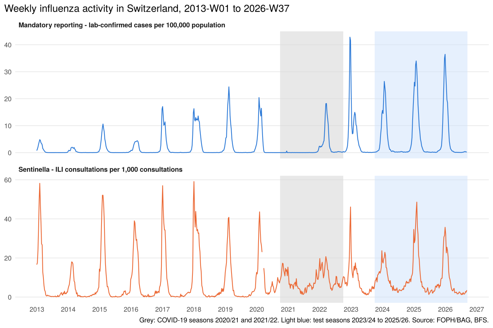
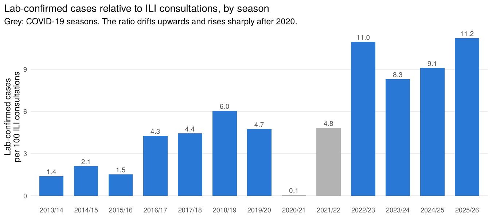

WP 4.1 – Data Preparation
================
L. Zovkic (responsible), S. Ryf (feedback)
10 October 2026

- [1 Data and vintage](#1-data-and-vintage)
- [2 Structure of the raw files](#2-structure-of-the-raw-files)
- [3 Quality checks](#3-quality-checks)
- [4 Implementation of the Preliminary
  Study](#4-implementation-of-the-preliminary-study)
- [5 First look at the national
  series](#5-first-look-at-the-national-series)
- [6 Season overview](#6-season-overview)
- [7 Open issues for the team](#7-open-issues-for-the-team)
- [8 Output files](#8-output-files)

This report documents work package 4.1 of the Preliminary Study. It is
generated by `scripts/01_data_preparation.R` (data) and this file
(report); every number below is computed, not typed. All steps follow
Sections 3 and 4.1 of the Preliminary Study; where the raw data required
an interpretation, it is stated in section 4 of this report.

# 1 Data and vintage

| Source                                 | File                       | Observations × variables | Weeks                            |
|----------------------------------------|----------------------------|--------------------------|----------------------------------|
| FOPH/BAG mandatory reporting (“Oblig”) | `INFLUENZA_oblig.csv`      | 30,938 × 20              | 2013-W01 – 2026-W37              |
| FOPH/BAG Sentinella                    | `INFLUENZA_sentinella.csv` | 12,332 × 20              | 2013-W01 – 2026-W37              |
| BFS STATPOP                            | `population_ch_bfs.csv`    | 13 years                 | 2013 – 2025 (2025 used for 2026) |

**Vintage.** The Preliminary Study uses the FOPH/BAG download of 24
September 2026 (study period 2013-W01 to 2026-W37). The raw files in
this repository were downloaded on 10 October 2026 and additionally
contain 2026-W38 to W40 (31,073 / 12,383 rows). Directly after loading,
all weekly rows after 2026-W37 are removed. This reproduces **exactly**
the observations reported in the study (30,938 × 20 and 12,332 × 20;
checks `vintage_1`, `vintage_2`). Values of earlier weeks can still
differ marginally through backfilling; this cannot be checked without
the original file (limitation already stated in Section 4.4 of the
study).

# 2 Structure of the raw files

Each observation is a week × region × age group × sex stratum (Section
3). The strata are organised as several stratifications side by side:
each row breaks down at most one dimension (canton/Sentinella region,
age group, sex, or influenza type), the others are set to `all`. In
addition there are national totals, monthly and yearly values and (Oblig
only) three FOPH/BAG 10-year reference curves.

| Dataset    | valueCategory    | Time unit | Geo level         | Breakdown |   Rows |
|:-----------|:-----------------|:----------|:------------------|:----------|-------:|
| oblig      | cases            | iso_week  | CHFL              | agegroup  |  4,290 |
| oblig      | cases            | iso_week  | CHFL              | none      |    715 |
| oblig      | cases            | iso_week  | CHFL              | sex       |  2,145 |
| oblig      | cases            | iso_week  | CHFL              | type      |  2,145 |
| oblig      | cases            | iso_week  | canton            | none      | 19,305 |
| oblig      | cases            | iso_week  | country           | none      |  1,430 |
| oblig      | max_value_10y    | iso_week  | CHFL              | none      |    245 |
| oblig      | median_value_10y | iso_week  | CHFL              | none      |    245 |
| oblig      | min_value_10y    | iso_week  | CHFL              | none      |    245 |
| sentinella | consultations    | week      | country           | agegroup  |  4,290 |
| sentinella | consultations    | week      | country           | none      |    715 |
| sentinella | consultations    | week      | country           | sex       |  2,145 |
| sentinella | consultations    | week      | sentinella_region | none      |  5,005 |

**Implementation of “summed across strata” (Section 3).** Cases are
summed within one complete stratification, the cantons (26 cantons +
`unknown`), to national weekly counts for Switzerland. Summing over
*all* rows would count each case several times, because the
stratifications overlap. All stratifications add up exactly to the same
national total (checks `oblig_C1`–`oblig_C5`), so the choice of
stratification does not affect the result.

**Implementation of the national Sentinella rate (Section 3).** The
national rate is taken from the national values in the dataset. The
fallback “weighted mean of the regional rates” is implemented (weights:
number of consultations per region); it reproduces the national values
almost exactly (check `sent_C5`). It is not needed in practice: in the
two weeks without a national value (2020-W11, W12) the regional values
are missing as well.

# 3 Quality checks

Section 4.1: structure, time coverage, geographic and demographic
levels, missing values, completeness and duplicates.

| ID            | Check                                                                                                           | Result | Detail                                                                                                                                                                                                                |
|:--------------|:----------------------------------------------------------------------------------------------------------------|:-------|:----------------------------------------------------------------------------------------------------------------------------------------------------------------------------------------------------------------------|
| vintage_1     | Observations = Preliminary Study (Section 3)                                                                    | PASS   | 30,938 x 20 after restriction to \<= 2026-W37 (raw file: 31,073 rows); study: 30,938 x 20                                                                                                                             |
| vintage_2     | Observations = Preliminary Study (Section 3)                                                                    | PASS   | 12,332 x 20 after restriction to \<= 2026-W37 (raw file: 12,383 rows); study: 12,332 x 20                                                                                                                             |
| oblig_S1      | No duplicated keys                                                                                              | PASS   | 0 duplicated rows on (valueCategory, temporal, georegion, agegroup, sex, type)                                                                                                                                        |
| oblig_S2      | Weekly series has no missing ISO weeks                                                                          | PASS   | 2013-W01 to 2026-W37, 715 weeks, missing: none                                                                                                                                                                        |
| oblig_S3      | All rows flagged dataComplete = TRUE                                                                            | PASS   | 0 rows not complete                                                                                                                                                                                                   |
| sentinella_S1 | No duplicated keys                                                                                              | PASS   | 0 duplicated rows on (valueCategory, temporal, georegion, agegroup, sex)                                                                                                                                              |
| sentinella_S2 | Weekly series has no missing ISO weeks                                                                          | PASS   | 2013-W01 to 2026-W37, 715 weeks, missing: none                                                                                                                                                                        |
| sentinella_S3 | All rows flagged dataComplete = TRUE                                                                            | PASS   | 0 rows not complete                                                                                                                                                                                                   |
| oblig_C1      | CH + FL = CHFL national total                                                                                   | PASS   | 715 / 715 weeks equal                                                                                                                                                                                                 |
| oblig_C2      | Sum of cantons (incl. ‘unknown’) = CH                                                                           | PASS   | 715 / 715 weeks equal                                                                                                                                                                                                 |
| oblig_C3      | Sum of age groups (incl. ‘unknown’) = CHFL                                                                      | PASS   | 715 / 715 weeks equal                                                                                                                                                                                                 |
| oblig_C4      | Sum of sexes (incl. ‘unknown’) = CHFL                                                                           | PASS   | 715 / 715 weeks equal                                                                                                                                                                                                 |
| oblig_C5      | Sum of types A + B + unknown = CHFL                                                                             | PASS   | 715 / 715 weeks equal                                                                                                                                                                                                 |
| oblig_C6      | BAG `pop` column equals BFS reference population                                                                | PASS   | 13 of 13 years identical                                                                                                                                                                                              |
| oblig_C7      | No negative case counts                                                                                         | PASS   | 0 negative values                                                                                                                                                                                                     |
| sent_C1       | National ILI rate (CH) available for every week                                                                 | WARN   | missing weeks: 2020-W11 2020-W12                                                                                                                                                                                      |
| sent_C2       | Info: regional values are extrapolated separately (not additive) -\> national row used                          | PASS   | median \|sum(regions) - CH\| / CH = 5.1%                                                                                                                                                                              |
| sent_C3       | incValue = value / population x 100,000 (plausible population 7.5-9.5 Mio.)                                     | PASS   | implied population 8.14 to 9.13 Mio.                                                                                                                                                                                  |
| sent_C4       | No negative ILI values                                                                                          | PASS   | NA                                                                                                                                                                                                                    |
| sent_C5       | Weighted mean of regions reproduces national ILI rate (validates fallback)                                      | PASS   | 713 weeks; abs diff per 1,000 consultations: median 0.025, max 0.56; r = 1.0000                                                                                                                                       |
| levels_1      | Share ‘unknown’ \< 1% in every stratification                                                                   | PASS   | agegroup 0.11%, canton 0.06%, sex 0.39%, type 0.81%                                                                                                                                                                   |
| levels_2      | Info: ‘unknown’ strata contain no values                                                                        | PASS   | agegroup: 0 weeks with value, sentinella_region: 0 weeks with value, sex: 0 weeks with value                                                                                                                          |
| levels_3      | Expected number of levels per stratification                                                                    | PASS   | oblig/agegroup: 6, oblig/canton: 27, oblig/sex: 3, oblig/type: 3, sentinella/agegroup: 6, sentinella/sentinella_region: 7, sentinella/sex: 3                                                                          |
| sent_V1       | Units confirmed against FOPH/BAG first publications (median dev. \< 10%; a unit error would be a factor 10/100) | PASS   | per 1,000 consultations: 9 weeks, median dev. 2.5%; per 100,000: 11 weeks, median dev. 7.3% (largest in holiday weeks: 2020-W01, 2016-W52)                                                                            |
| sent_V2       | Onset rule + published thresholds reproduce FOPH/BAG onset weeks                                                | WARN   | 2013/14: reported 2014-W04, ours 2014-W05; 2016/17: reported 2016-W50, ours 2016-W50; 2017/18: reported 2017-W51, ours 2017-W51; 2018/19: reported 2019-W02, ours 2019-W02; 2019/20: reported 2020-W02, ours 2020-W02 |
| final_1       | One row per ISO week in study period                                                                            | PASS   | 715 rows, 715 expected (2013-W01 to 2026-W37)                                                                                                                                                                         |
| final_2       | Target (oblig incidence) complete                                                                               | PASS   | 0 missing weeks                                                                                                                                                                                                       |
| final_3       | Own incidence (cantons summed / BFS) = FOPH/BAG incidence                                                       | PASS   | max abs diff 0.0050 (FOPH/BAG rounds to 2 decimals)                                                                                                                                                                   |
| final_4       | Sentinella ILI rate complete in study period                                                                    | WARN   | missing (national and all regions): 2020-W11 2020-W12; filled by regional weighted mean: 0 weeks                                                                                                                      |
| final_5       | Leakage-prone BAG columns excluded                                                                              | PASS   | trend, deltaValue, deltaIncValue, incValuePrctChange, valueMean5y, inc14d                                                                                                                                             |

**Missing values.** The target has no missing weeks. The Sentinella ILI
rate is missing for **2020-W11 and 2020-W12** (start of the COVID-19
lockdown), nationally and in all regions. These weeks lie in the
training period of every forecast origin; they are kept as `NA` and
flagged (`sentinella_missing`). Their handling in the models
(e.g. interpolation of the lagged predictor) is decided in WP 4.4.

| Dataset    | Column            | Missing |   Rows | % missing |
|:-----------|:------------------|--------:|-------:|----------:|
| oblig      | value             |       0 | 30,938 |       0.0 |
| oblig      | pop               |   2,969 | 30,938 |       9.6 |
| oblig      | incValue          |   2,234 | 30,938 |       7.2 |
| sentinella | value             |   2,173 | 12,332 |      17.6 |
| sentinella | incValue          |   2,173 | 12,332 |      17.6 |
| sentinella | prctConsultations |   2,173 | 12,332 |      17.6 |

**Geographic and demographic levels.** Every stratification has the
expected levels (26 cantons + `unknown`, 5 age groups + `unknown`,
female/male/`unknown`, 6 Sentinella regions + `unknown`). In the
mandatory reporting system the share of cases with unknown canton, age
group, sex or type is below 1 % (check `levels_1`). The Sentinella
`unknown` strata are empty placeholders.

| System     | Stratification    | Level    | Total 2013-W01 to 2026-W37 | % of stratification |
|:-----------|:------------------|:---------|---------------------------:|--------------------:|
| oblig      | agegroup          | 0 - 4    |                     17,092 |                9.74 |
| oblig      | agegroup          | 15 - 29  |                     16,834 |                9.59 |
| oblig      | agegroup          | 30 - 64  |                     53,848 |               30.69 |
| oblig      | agegroup          | 5 - 14   |                     17,495 |                9.97 |
| oblig      | agegroup          | 65+      |                     70,016 |               39.90 |
| oblig      | agegroup          | unknown  |                        200 |                0.11 |
| oblig      | canton            | unknown  |                         99 |                0.06 |
| oblig      | sex               | female   |                     90,821 |               51.75 |
| oblig      | sex               | male     |                     83,978 |               47.85 |
| oblig      | sex               | unknown  |                        686 |                0.39 |
| oblig      | type              | A        |                    142,682 |               81.31 |
| oblig      | type              | B        |                     31,383 |               17.88 |
| oblig      | type              | unknown  |                      1,420 |                0.81 |
| sentinella | agegroup          | 0 - 4    |                    302,021 |                8.95 |
| sentinella | agegroup          | 15 - 29  |                    678,446 |               20.10 |
| sentinella | agegroup          | 30 - 64  |                  1,589,555 |               47.10 |
| sentinella | agegroup          | 5 - 14   |                    449,846 |               13.33 |
| sentinella | agegroup          | 65+      |                    354,691 |               10.51 |
| sentinella | agegroup          | unknown  |                          0 |                0.00 |
| sentinella | sentinella_region | region_1 |                    682,807 |               19.97 |
| sentinella | sentinella_region | region_2 |                    502,081 |               14.68 |
| sentinella | sentinella_region | region_3 |                    483,474 |               14.14 |
| sentinella | sentinella_region | region_4 |                    245,810 |                7.19 |
| sentinella | sentinella_region | region_5 |                  1,099,725 |               32.16 |
| sentinella | sentinella_region | region_6 |                    405,702 |               11.86 |
| sentinella | sentinella_region | unknown  |                          0 |                0.00 |
| sentinella | sex               | female   |                  1,763,040 |               51.54 |
| sentinella | sex               | male     |                  1,657,804 |               48.46 |
| sentinella | sex               | unknown  |                          0 |                0.00 |

Cantons (shares of all reported cases in Switzerland):

ZH 13.4%, VD 12.5%, GE 10.1%, BE 10.0%, TI 6.7%, AG 6.7%, VS 5.7%, BS
4.5%, BL 3.9%, LU 3.7%, SG 3.4%, SO 3.2%, FR 2.8%, TG 2.6%, NE 2.2%, GR
2.1%, JU 1.5%, SZ 1.4%, ZG 1.0%, SH 0.8%, NW 0.5%, UR 0.4%, GL 0.4%, OW
0.3%, AR 0.3%, AI 0.1%, unknown 0.1%

Totals for Sentinella are extrapolated ILI consultations. Regional
variation is only described (Section 4.2), not used in the forecasting
models.

Missing `pop`/`incValue` in the raw Oblig file occur only in `unknown`
strata, in the 10-year reference curves and for Liechtenstein in some
weeks; none of these enter the national series.

**Validation against FOPH/BAG publications.** The meaning of the raw
Sentinella columns is not documented by FOPH/BAG. It was therefore
validated against 15 weekly values that FOPH/BAG published at the time
(quoted in media reports and HUG bulletins,
`data/reference/bag_reported_values.csv`): `prctConsultations` × 10
matches the published “Grippeverdachtsfälle pro 1000 Konsultationen” and
`incValue` the published “pro 100 000 Einwohner” (check `sent_V1`).
Deviations are due to backfilling after the first publication and are
largest in the holiday weeks around New Year. With the published
thresholds, the onset rule of Section 4.2 reproduces the onset week
reported by FOPH/BAG in 4 of 5 seasons (check `sent_V2`); in 2013/14 the
value of 2014-W04 was revised from 75 to 72.7 after publication, so the
onset moves from W04 to W05.

# 4 Implementation of the Preliminary Study

| Study (section)                                                                    | Implementation                                                                                                                                                | Check                                                     |
|------------------------------------------------------------------------------------|---------------------------------------------------------------------------------------------------------------------------------------------------------------|-----------------------------------------------------------|
| Study period 2013-W01 to 2026-W37 (3)                                              | weekly rows after 2026-W37 removed after loading                                                                                                              | `vintage_1/2`, `final_1`                                  |
| Target: weekly national incidence of lab-confirmed influenza per 100,000 (3)       | `oblig_inc_100k` = cases summed over cantons / BFS population × 100,000                                                                                       | `final_3`: identical to FOPH/BAG incidence up to rounding |
| BFS population of the respective year, 2025 for 2026 (3)                           | `population`, 31 December of the ISO year                                                                                                                     | `oblig_C6`: identical to FOPH/BAG `pop`                   |
| Sentinella ILI consultations per 1,000 consultations (3)                           | `sentinella_ili_rate` = national `prctConsultations` × 10                                                                                                     | –                                                         |
| National Sentinella rate from national values, else weighted regional mean (3)     | `sentinella_source` documents the origin per week                                                                                                             | `sent_C5`                                                 |
| Predictors: lagged target, lagged Sentinella rate, calendar week (3)               | `oblig_inc_100k`, `sentinella_ili_rate`, `iso_wk`; lags are created in WP 4.4                                                                                 | –                                                         |
| Region, age group, sex only for aggregation and descriptives (3)                   | separate file `flu_weekly_strata_long.csv`                                                                                                                    | –                                                         |
| No predictors with information from the prediction period (4.1)                    | FOPH/BAG `trend`, `delta*`, `valueMean5y`, `inc14d`, 10-year curves dropped                                                                                   | `final_5`                                                 |
| COVID-19 seasons 2020/21 and 2021/22 flagged (4.1)                                 | `covid_season`                                                                                                                                                | tests                                                     |
| Post-2020 indicator; pre-2020 = 2013/14–2019/20, post-2020 = 2022/23–2025/26 (4.1) | `post2020`, `period`                                                                                                                                          | tests                                                     |
| Seasons W40–W39, test seasons 2023/24–2025/26 (4.5)                                | `season`, `season_week`, `test_season`                                                                                                                        | tests                                                     |
| Season onset: Sentinella ILI rate above the FOPH/BAG epidemic threshold (4.2)      | `sentinella_ili_inc` (per 100,000 inhabitants, the scale of the FOPH/BAG threshold), published thresholds in `epidemic_thresholds.csv`, `season_boundaries()` | `sent_V2`; see section 7                                  |

Interpretation needed: Switzerland without Liechtenstein, because the
BFS denominator refers to Switzerland (Liechtenstein = 0.46 % of all
reported cases).

# 5 First look at the national series

<!-- -->

<!-- -->

**Observation relevant for 4.3/4.4.** Per 100 ILI consultations, the
mandatory reporting system recorded on average 3.5 lab-confirmed cases
in 2013/14–2019/20 and 9.9 in 2022/23–2025/26 (factor 2.8); the ratio
already drifts upwards before 2020. This is consistent with the change
in testing behaviour anticipated in Section 4.1 and supports the planned
post-2020 indicator and the separate lag analysis for pre- and post-2020
seasons. In addition, ILI is a *syndromic* measure: from 2020 onwards it
also captures COVID-19 and other respiratory viruses (visible as the ILI
rise in autumn 2020 with almost no influenza cases).

# 6 Season overview

| Season  | Period          | Weeks |  Cases | Peak week (Oblig) | Peak incidence (Oblig) | Peak week (Sentinella) | Peak ILI per 1,000 consultations |
|:--------|:----------------|------:|-------:|:------------------|-----------------------:|:-----------------------|---------------------------------:|
| 2012/13 | pre2020_partial |    39 |  2,865 | 2013-W06          |                   4.82 | 2013-W06               |                             58.2 |
| 2013/14 | pre2020         |    52 |  1,587 | 2014-W08          |                   1.99 | 2014-W07               |                             18.0 |
| 2014/15 | pre2020         |    52 |  5,929 | 2015-W07          |                  10.62 | 2015-W06               |                             52.1 |
| 2015/16 | pre2020         |    53 |  3,826 | 2016-W11          |                   4.41 | 2016-W06               |                             39.0 |
| 2016/17 | pre2020         |    52 |  9,627 | 2017-W01          |                  17.09 | 2017-W01               |                             57.0 |
| 2017/18 | pre2020         |    52 | 15,220 | 2018-W01          |                  16.30 | 2018-W01               |                             59.1 |
| 2018/19 | pre2020         |    52 | 13,790 | 2019-W07          |                  24.39 | 2019-W07               |                             40.8 |
| 2019/20 | pre2020         |    52 | 11,882 | 2020-W05          |                  20.43 | 2020-W06               |                             43.6 |
| 2020/21 | covid           |    53 |    104 | 2020-W51          |                   0.59 | 2020-W44               |                             17.3 |
| 2021/22 | covid           |    52 | 12,356 | 2022-W12          |                  18.23 | 2022-W11               |                             20.7 |
| 2022/23 | post2020        |    52 | 24,963 | 2022-W51          |                  42.81 | 2022-W52               |                             46.1 |
| 2023/24 | post2020        |    52 | 19,666 | 2024-W04          |                  26.42 | 2023-W52               |                             23.7 |
| 2024/25 | post2020        |    52 | 28,065 | 2025-W05          |                  33.99 | 2025-W06               |                             48.6 |
| 2025/26 | post2020        |    50 | 24,804 | 2026-W01          |                  36.45 | 2026-W01               |                             35.7 |

2012/13 starts in W01 (study start) and 2025/26 ends in W37 (study end),
so both are incomplete; for 2025/26 only the two off-season weeks
W38–W39 are missing. Peak week and peak intensity are formally analysed
in WP 4.2.

# 7 Open issues for the team

See `docs/open_issues.md`. Most important: published FOPH/BAG thresholds
were found for 2013/14, 2014/15 and 2016/17 to 2019/20 (not for
2015/16). FOPH/BAG has **not published an ILI epidemic threshold since
season 2020/21** (since 2023/24 the epidemic period is defined by 10 %
test positivity, which is not in our data). The season onset definition
of Section 4.2 can therefore not be applied to the post-2020 seasons,
including all test seasons, and needs a team decision.

# 8 Output files

| File                                        | Content                                                                                 |
|---------------------------------------------|-----------------------------------------------------------------------------------------|
| `data/processed/flu_weekly_national.csv`    | one row per ISO week, both systems, population, flags (see `docs/data_dictionary.md`)   |
| `data/processed/flu_weekly_strata_long.csv` | all breakdowns (canton, Sentinella region, age group, sex, type) in long format for 4.2 |
| `output/qc/qc_checks.csv`                   | all quality checks                                                                      |
| `output/qc/levels_overview.csv`             | totals and shares per canton, Sentinella region, age group, sex, type                   |
| `output/qc/season_summary.csv`              | peaks per season, onset/end where a threshold is available                              |
| `data/reference/epidemic_thresholds.csv`    | published FOPH/BAG thresholds with sources                                              |
| `data/reference/bag_reported_values.csv`    | published weekly FOPH/BAG values used for validation                                    |
