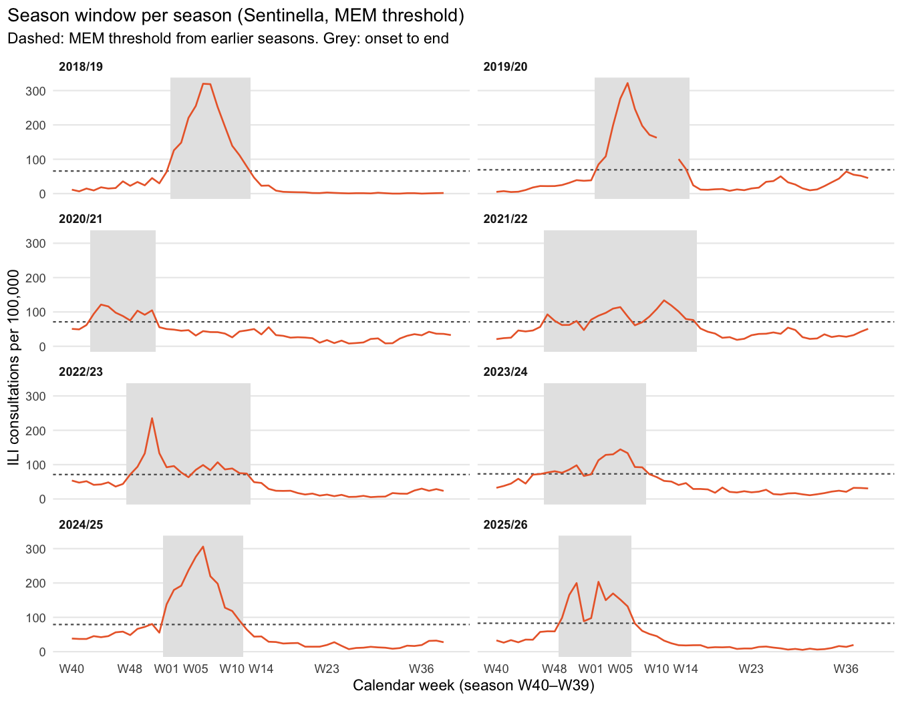
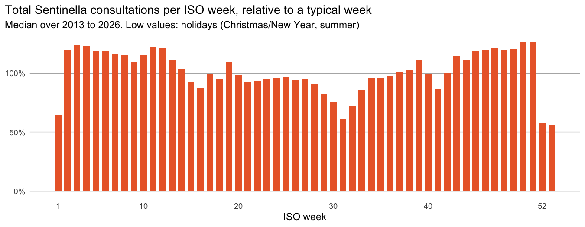
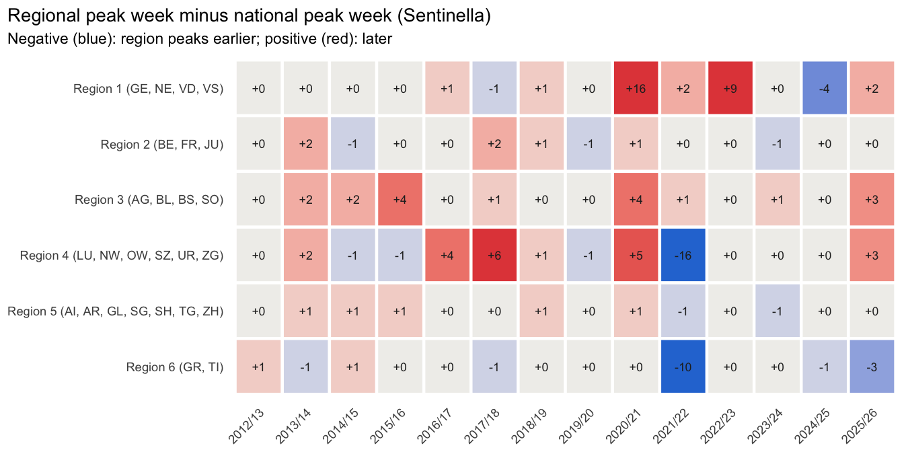

WP 4.2 – Exploratory Analysis
================
S. Ryf (responsible), L. Zovkic (feedback)
27 October 2026

- [1 Data](#1-data)
- [2 Seasonal patterns](#2-seasonal-patterns)
- [3 Peak timing and intensity](#3-peak-timing-and-intensity)
- [4 Season onset and end](#4-season-onset-and-end)
- [5 Unusual observations](#5-unusual-observations)
- [6 Regional variation](#6-regional-variation)
- [7 Key findings for WP 4.3–4.5](#7-key-findings-for-wp-4345)

This report documents work package 4.2 of the Preliminary Study. It is
generated by `scripts/02_eda.R` (tables) and this file (report) from the
datasets of WP 4.1; every number below is computed, not typed.

# 1 Data

The analysis uses the national weekly series (715 ISO weeks, 2013-W01 to
2026-W37, 14 seasons) and the stratified long table (39,325 rows).
Seasons run from W40 to W39. Summary statistics across seasons exclude
the incomplete season 2012/13 and 2020/21 (no influenza circulation);
both are still shown and flagged. Season 2025/26 is included: only the
off-season weeks W38–W39 are missing.

| Season  | Period          | Weeks | Complete | In summary statistics | Test season |
|:--------|:----------------|------:|:---------|:----------------------|:------------|
| 2012/13 | pre2020_partial |    39 | FALSE    | FALSE                 | FALSE       |
| 2013/14 | pre2020         |    52 | TRUE     | TRUE                  | FALSE       |
| 2014/15 | pre2020         |    52 | TRUE     | TRUE                  | FALSE       |
| 2015/16 | pre2020         |    53 | TRUE     | TRUE                  | FALSE       |
| 2016/17 | pre2020         |    52 | TRUE     | TRUE                  | FALSE       |
| 2017/18 | pre2020         |    52 | TRUE     | TRUE                  | FALSE       |
| 2018/19 | pre2020         |    52 | TRUE     | TRUE                  | FALSE       |
| 2019/20 | pre2020         |    52 | TRUE     | TRUE                  | FALSE       |
| 2020/21 | covid           |    53 | TRUE     | FALSE                 | FALSE       |
| 2021/22 | covid           |    52 | TRUE     | TRUE                  | FALSE       |
| 2022/23 | post2020        |    52 | TRUE     | TRUE                  | FALSE       |
| 2023/24 | post2020        |    52 | TRUE     | TRUE                  | TRUE        |
| 2024/25 | post2020        |    52 | TRUE     | TRUE                  | TRUE        |
| 2025/26 | post2020        |    50 | FALSE    | TRUE                  | TRUE        |

# 2 Seasonal patterns

<!-- -->

**Overall pattern.** Both systems show one clear winter wave per season,
with low activity between seasons. The COVID-19 seasons interrupt the
pattern (2020/21 almost without influenza, 2021/22 with a late spring
wave). From 2022/23 the mandatory reporting system runs at a clearly
higher level, while the Sentinella ILI rate does not rise to the same
extent.

<!-- -->

<!-- -->

| System | Period | Seasons | Weeks | Mean | Median | 90th pct. | Max | % weeks = 0 |
|:---|:---|---:|---:|---:|---:|---:|---:|---:|
| Mandatory reporting (cases per 100,000) | pre2020_partial | 1 | 39 | 0.90 | 0.01 | 3.45 | 4.82 | 35.9 |
| Mandatory reporting (cases per 100,000) | pre2020 | 7 | 365 | 1.99 | 0.07 | 7.94 | 24.39 | 15.9 |
| Mandatory reporting (cases per 100,000) | covid | 2 | 105 | 1.35 | 0.03 | 2.94 | 18.23 | 22.9 |
| Mandatory reporting (cases per 100,000) | post2020 | 4 | 206 | 5.23 | 0.48 | 19.10 | 42.81 | 0.0 |
| Sentinella (ILI per 1,000 consultations) | pre2020_partial | 1 | 39 | 9.91 | 0.70 | 35.76 | 58.20 | 0.0 |
| Sentinella (ILI per 1,000 consultations) | pre2020 | 7 | 363 | 7.48 | 2.00 | 27.16 | 59.10 | 3.0 |
| Sentinella (ILI per 1,000 consultations) | covid | 2 | 105 | 8.39 | 6.80 | 15.06 | 20.70 | 0.0 |
| Sentinella (ILI per 1,000 consultations) | post2020 | 4 | 206 | 9.39 | 5.70 | 21.95 | 48.60 | 0.0 |

Weekly values per period

**Interpretation.** Influenza activity shows a clear seasonal pattern in
both systems: activity starts to rise in December, peaks between late
December and February and goes down to baseline by April. After 2020,
the typical season has shifted: the median curve of mandatory reporting
peaks around W52 in 2022/23–2025/26 compared with W05 before 2020, and
Sentinella shows the same shift (W01 vs W07). The level of mandatory
reporting has roughly doubled (median weekly peak curve 26 vs 11 cases
per 100’000), while the Sentinella ILI rate has not risen (29 vs 35 per
1’000 consultations). The seasons vary considerably in terms of their
timing and intensity, so a single “average season” does not, on its own,
represent a reliable forecast.

# 3 Peak timing and intensity

Peak week = week of maximum weekly value, peak intensity = that maximum
(Section 4.2), determined separately for both systems. If two weeks
share the maximum, the first is used. The peak lag is the oblig peak
week minus the Sentinella peak week (positive: Sentinella peaks
earlier).

For Sentinella the peak week is determined on two scales. The study
predictor, ILI per 1,000 consultations, is a *share* of all
consultations; in the holiday weeks W52/W53/W01 total consultations drop
to about 60% (section 5), which inflates this share. As a robustness
check the peak week is therefore also determined on ILI consultations
per 100,000 inhabitants, which is not affected by the drop in total
consultations.

| Season | Period | Peak week (oblig) | Peak (cases/100k) | Peak week (Sentinella, per 1,000 cons.) | Peak (ILI/1,000) | Lag (weeks) | Peak week (Sentinella, per 100,000) | Lag (weeks, per 100,000) | Note |
|:---|:---|:---|---:|:---|---:|---:|:---|---:|:---|
| 2012/13 | pre2020_partial | 2013-W06 | 4.8 | 2013-W06 | 58.2 | 0 | 2013-W06 | 0 | incomplete season |
| 2013/14 | pre2020 | 2014-W08 | 2.0 | 2014-W07 | 18.0 | 1 | 2014-W07 | 1 |  |
| 2014/15 | pre2020 | 2015-W07 | 10.6 | 2015-W06 | 52.1 | 1 | 2015-W06 | 1 |  |
| 2015/16 | pre2020 | 2016-W11 | 4.4 | 2016-W06 | 39.0 | 5 | 2016-W06 | 5 |  |
| 2016/17 | pre2020 | 2017-W01 | 17.1 | 2017-W01 | 57.0 | 0 | 2017-W02 | -1 |  |
| 2017/18 | pre2020 | 2018-W01 | 16.3 | 2018-W01 | 59.1 | 0 | 2018-W02 | -1 |  |
| 2018/19 | pre2020 | 2019-W07 | 24.4 | 2019-W07 | 40.8 | 0 | 2019-W06 | 1 |  |
| 2019/20 | pre2020 | 2020-W05 | 20.4 | 2020-W06 | 43.6 | -1 | 2020-W06 | -1 |  |
| 2020/21 | covid | 2020-W51 | 0.6 | 2020-W44 | 17.3 | 7 | 2020-W44 | 7 | no influenza season |
| 2021/22 | covid | 2022-W12 | 18.2 | 2022-W11 | 20.7 | 1 | 2022-W11 | 1 |  |
| 2022/23 | post2020 | 2022-W51 | 42.8 | 2022-W52 | 46.1 | -1 | 2022-W51 | 0 |  |
| 2023/24 | post2020 | 2024-W04 | 26.4 | 2023-W52 | 23.7 | 4 | 2024-W05 | -1 | test season |
| 2024/25 | post2020 | 2025-W05 | 34.0 | 2025-W06 | 48.6 | -1 | 2025-W06 | -1 | test season |
| 2025/26 | post2020 | 2026-W01 | 36.5 | 2026-W01 | 35.7 | 0 | 2026-W02 | -1 | incomplete season |

<!-- -->

<!-- -->

| Period | Seasons | Mean peak week oblig (SD in weeks, range) | Mean peak week Sentinella (SD) | Median peak oblig | Median peak Sentinella | Mean lag in weeks (range) | Mean lag per 100,000 (range) |
|:---|---:|:---|:---|---:|---:|:---|:---|
| pre2020 | 7 | W06 (SD 3.9, W01 to W12) | W05 (SD 2.8) | 16.3 | 43.6 | 0.9 (-1 to 5) | 0.7 (-1 to 5) |
| covid | 1 | W12 (SD NA, W12 to W12) | W11 (SD NA) | 18.2 | 20.7 | 1.0 (1 to 1) | 1.0 (1 to 1) |
| post2020 | 4 | W02 (SD 2.8, W51 to W05) | W02 (SD 2.9) | 35.2 | 40.9 | 0.5 (-1 to 4) | -0.8 (-1 to 0) |

Peak timing and intensity by period (seasons in summary statistics only)

With ILI per 1,000 consultations, the Sentinella peak comes before the
oblig peak in 6 of 14 seasons, in the same week in 5 and after it in 3.
With ILI per 100,000 inhabitants the counts are 6, 2 and 6. The two
scales disagree in 6 seasons; in 5 seasons (2016/17, 2017/18, 2022/23,
2023/24, 2025/26) the peak per 1,000 consultations falls into a holiday
week, on the per-100,000 scale in none.

**Interpretation.** Before 2020 the oblig peak fell on average in season
week 19 (about W06, SD 3.9 weeks, range W01–W11); from 2022/23 it came
about three to four weeks earlier (about W02, SD 2.8 weeks). Peak
intensity in mandatory reporting more than doubled (median 35 vs 16
cases per 100’000), where the Sentinella peak stayed at the same level
(median 41 vs 44 per 1’000 consultations). The higher oblig peaks are
therefore consistent with more testing rather than more severe influenza
seasons. On the per-100,000 scale the peaks of both systems lie at most
one week apart in 11 of 12 seasons in summary statistics (exception:
2015/16, section 5), but the direction is not consistent: before 2020
Sentinella tends to peak slightly earlier, from 2022/23 slightly later
(mean lag 0.7 vs -0.8 weeks). Peak timing therefore shows that the
systems are closely aligned, but it does not indicate a systematic
Sentinella lead; whether Sentinella leads the mandatory reporting system
is tested with the cross-correlation analysis of WP 4.3 (lags 0–3 weeks,
as planned).

# 4 Season onset and end

**Method.** Section 4.2 defines the onset as the first of two
consecutive weeks in which the Sentinella ILI rate exceeds the FOPH/BAG
epidemic threshold of the season, and the end as the last week above it.
FOPH/BAG has not published an ILI threshold since 2020/21, so – as
decided by the team on 15.10.2026 – the threshold is estimated with the
Moving Epidemic Method (MEM; Vega et al. 2013, R package `mem`), on the
same scale as the FOPH/BAG threshold (ILI consultations per 100,000
inhabitants). For each season the threshold is estimated **only from
earlier seasons** (at most 10, at least 5; complete seasons without
COVID-19 seasons and without the lockdown weeks 2020), so no information
from the season itself is used. With fewer than 5 earlier seasons the
estimate is unstable, therefore MEM thresholds are available from
2018/19 onwards, which covers all test seasons.

**Validation against FOPH/BAG.** Estimated from all seven pre-2020
seasons, MEM gives a threshold of 71.2 per 100,000, within the range of
the published FOPH/BAG thresholds (64–74). With this threshold, the
onset rule reproduces the onset week reported by FOPH/BAG in 4 of 5
seasons; the prospective MEM thresholds reproduce it in both seasons
where they are available (2018/19, 2019/20).

| Season | FOPH/BAG threshold | MEM (prospective) | MEM (all pre-2020) | Onset reported by FOPH/BAG | Onset with FOPH/BAG threshold | Onset with MEM (prospective) | Onset with MEM (all pre-2020) |
|:---|---:|---:|---:|:---|:---|:---|:---|
| 2013/14 | 74 | NA | 71.2 | 2014-W04 | 2014-W05 | NA | 2014-W04 |
| 2014/15 | 70 | NA | 71.2 | NA | 2015-W02 | NA | 2015-W02 |
| 2015/16 | NA | NA | 71.2 | NA | NA | NA | 2016-W02 |
| 2016/17 | 64 | NA | 71.2 | 2016-W50 | 2016-W50 | NA | 2016-W51 |
| 2017/18 | 68 | NA | 71.2 | 2017-W51 | 2017-W51 | NA | 2017-W51 |
| 2018/19 | 68 | 65.7 | 71.2 | 2019-W02 | 2019-W02 | 2019-W02 | 2019-W02 |
| 2019/20 | 69 | 69.2 | 71.2 | 2020-W02 | 2020-W02 | 2020-W02 | 2020-W02 |

Thresholds per 100,000 inhabitants and resulting onset weeks, pre-2020
seasons

| Season | MEM threshold | Onset | End | Duration (weeks) | Peak Sentinella | Peak oblig | Oblig cases in window |
|:---|---:|:---|:---|---:|:---|:---|:---|
| 2018/19 | 65.7 | 2019-W02 | 2019-W12 | 11 | 2019-W07 | 2019-W07 | 89% |
| 2019/20 | 69.2 | 2020-W02 | 2020-W14 | 13 | 2020-W06 | 2020-W05 | 93% |
| 2020/21 | 71.2 | 2020-W43 | 2020-W51 | 9 | 2020-W44 | 2020-W51 | 58% |
| 2021/22 | 71.2 | 2021-W47 | 2022-W15 | 21 | 2022-W11 | 2022-W12 | 89% |
| 2022/23 | 71.2 | 2022-W48 | 2023-W12 | 17 | 2022-W52 | 2022-W51 | 92% |
| 2023/24 | 73.1 | 2023-W47 | 2024-W08 | 14 | 2023-W52 | 2024-W04 | 86% |
| 2024/25 | 79.1 | 2025-W01 | 2025-W11 | 11 | 2025-W06 | 2025-W05 | 80% |
| 2025/26 | 82.8 | 2025-W49 | 2026-W06 | 10 | 2026-W01 | 2026-W01 | 86% |

Season boundaries from Sentinella (MEM), applied to mandatory reporting

<!-- -->

**Interpretation.** With a MEM threshold, seasons start between W47 and
W02 and last 10–17 weeks in regular seasons (21 weeks in 2021/22). The
threshold rises after 2020 (from 71 to 83 per 100,000) because the
Sentinella baseline is higher (section 5), not because influenza seasons
are stronger. The Sentinella window contains 80–93% of the lab-confirmed
cases of a season and always includes the oblig peak, so it is a
reasonable definition of in-season weeks for both systems. Exceptions:
in 2020/21 the threshold was exceeded without influenza circulation, and
the end of 2019/20 (W14) falls into the lockdown weeks and is uncertain.
The in-season weeks for WP 4.5 are in `output/eda/in_season_weeks.csv`;
all three test seasons have a prospective MEM threshold.

**Variation of onset across seasons (RQ1).** The prospective threshold
needs at least 5 earlier seasons and therefore gives an onset only from
2018/19. For the descriptive question RQ1 leakage is irrelevant, so the
seasons 2013/14–2017/18 use the retrospective MEM threshold from all
pre-2020 seasons (71.2 per 100,000). These descriptive boundaries are
used only for RQ1; the in-season weeks for WP 4.5 remain the prospective
ones above.

| Season | Threshold | Threshold (per 100,000) | Onset | End | Duration (weeks) |
|:---|:---|---:|:---|:---|---:|
| 2013/14 | MEM retrospective (all pre-2020 seasons) | 71.2 | 2014-W04 | 2014-W10 | 7 |
| 2014/15 | MEM retrospective (all pre-2020 seasons) | 71.2 | 2015-W02 | 2015-W12 | 11 |
| 2015/16 | MEM retrospective (all pre-2020 seasons) | 71.2 | 2016-W02 | 2016-W13 | 12 |
| 2016/17 | MEM retrospective (all pre-2020 seasons) | 71.2 | 2016-W51 | 2017-W08 | 10 |
| 2017/18 | MEM retrospective (all pre-2020 seasons) | 71.2 | 2017-W51 | 2018-W13 | 15 |
| 2018/19 | MEM prospective (earlier seasons only) | 65.7 | 2019-W02 | 2019-W12 | 11 |
| 2019/20 | MEM prospective (earlier seasons only) | 69.2 | 2020-W02 | 2020-W14 | 13 |
| 2020/21 | MEM prospective (earlier seasons only) | 71.2 | 2020-W43 | 2020-W51 | 9 |
| 2021/22 | MEM prospective (earlier seasons only) | 71.2 | 2021-W47 | 2022-W15 | 21 |
| 2022/23 | MEM prospective (earlier seasons only) | 71.2 | 2022-W48 | 2023-W12 | 17 |
| 2023/24 | MEM prospective (earlier seasons only) | 73.1 | 2023-W47 | 2024-W08 | 14 |
| 2024/25 | MEM prospective (earlier seasons only) | 79.1 | 2025-W01 | 2025-W11 | 11 |
| 2025/26 | MEM prospective (earlier seasons only) | 82.8 | 2025-W49 | 2026-W06 | 10 |

Season boundaries for RQ1 (all seasons)

| Period | Seasons | Mean onset (SD, range) | Mean end | Mean duration in weeks (range) |
|:---|---:|:---|:---|:---|
| pre2020 | 7 | W02 (SD 1.9 weeks, W51 to W04) | W12 | 11.3 (7 to 15) |
| covid | 1 | W47 | W15 | 21.0 (21 to 21) |
| post2020 | 4 | W49 (SD 2.6 weeks, W47 to W01) | W09 | 13.0 (10 to 17) |

Season onset, end and duration by period (seasons in summary statistics)

Before 2020 the season started on average around W02 (SD 1.9 weeks,
range W51–W04), from 2022/23 around W49 (SD 2.6 weeks, range W47–W01),
i.e. about 4 weeks earlier, in line with the earlier peaks (section 3).
Outside the COVID-19 seasons the season lasts between 7 and 17 weeks.
Onset thus varies by several weeks between seasons, somewhat less than
peak timing (SD 1.9 vs 3.9 weeks before 2020).

# 5 Unusual observations

1.  **Lockdown in spring 2020.** From 2020-W11 lab-confirmed cases fell
    from 890 (W10) to 3 (W15), and Sentinella has no values in 2020-W11
    and W12. The weeks from 2020-W11 to the end of season 2019/20 are
    flagged (`lockdown_2020`) and left out of the typical-season curves
    and the MEM training data.
2.  **ILI without influenza in autumn 2020.** In 2020/21 the Sentinella
    ILI rate exceeded the MEM threshold from 2020-W43 to 2020-W51, while
    the whole season had only 104 lab-confirmed influenza cases. Since
    2020, ILI also captures SARS-CoV-2 and other respiratory viruses;
    the “season” defined by Sentinella alone is not an influenza season
    here.
3.  **Higher Sentinella baseline after 2020.** Outside the season
    (W23–W36), the median ILI rate was 0.2 per 1,000 consultations
    before 2020 and 2.6 from 2022/23 – about 10 times higher. This
    raises the MEM threshold for later seasons (section 4) and weakens
    the link between ILI and influenza (relevant for WP 4.3).
4.  **Late spring wave 2021/22.** After two seasons with almost no
    influenza, the oblig peak came only in 2022-W12 (week 25 of the
    season; only 2015/16 peaked as late).
5.  **Large peak gaps between the systems.** In 2015/16 the oblig peak
    (2016-W11) came 5 weeks after the Sentinella peak. That season was
    dominated by influenza B (53% of cases), and both types peaked late
    (A: 2016-W11, B: 2016-W12) although ILI consultations had already
    peaked. In 2023/24 the Sentinella peak per 1,000 consultations falls
    in 2023-W52, four weeks before the oblig peak (2024-W04). This is a
    holiday effect (observation 6): per 100,000 inhabitants ILI *fell*
    from 98 (W51) to 67 (W52) and peaked only in 2024-W05, one week
    after the oblig peak.
6.  **Holiday weeks.** Around Christmas and New Year the total number of
    Sentinella consultations drops to about 56–65% of a typical week.
    Because the predictor is a *share* of consultations (ILI per 1,000
    consultations), it can rise in these weeks even if ILI cases do not.
    This shifts the Sentinella peak into a holiday week in 5 seasons
    (section 3) and is relevant for the predictor in WP 4.3/4.4.

| Season  | Type A | Type B | Share B | Peak week A | Peak week B |
|:--------|-------:|-------:|:--------|:------------|:------------|
| 2012/13 |   1543 |   1290 | 45%     | 2013-W06    | 2013-W07    |
| 2013/14 |   1507 |     36 | 2%      | 2014-W08    | 2014-W08    |
| 2014/15 |   4488 |   1403 | 24%     | 2015-W07    | 2015-W11    |
| 2015/16 |   1735 |   2034 | 53%     | 2016-W11    | 2016-W12    |
| 2016/17 |   9267 |    314 | 3%      | 2017-W01    | 2017-W10    |
| 2017/18 |   5317 |   9871 | 65%     | 2018-W10    | 2018-W01    |
| 2018/19 |  13530 |    101 | 1%      | 2019-W07    | 2019-W05    |
| 2019/20 |   8592 |   3083 | 26%     | 2020-W05    | 2020-W09    |
| 2020/21 |     75 |     27 | 26%     | 2020-W51    | 2020-W51    |
| 2021/22 |  12275 |     80 | 1%      | 2022-W12    | 2022-W18    |
| 2022/23 |  19611 |   5431 | 22%     | 2022-W51    | 2023-W08    |
| 2023/24 |  18911 |    798 | 4%      | 2024-W04    | 2024-W09    |
| 2024/25 |  21494 |   6601 | 23%     | 2025-W05    | 2025-W06    |
| 2025/26 |  24337 |    314 | 1%      | 2026-W01    | 2026-W01    |

Lab-confirmed cases by influenza type (CH + FL)

<!-- -->

# 6 Regional variation

Regional variation is described only: the forecasting target is national
and regional series rest on fewer practices and are noisier. The figure
shows, per Sentinella region and season, how many weeks the regional ILI
peak (per 100’000 inhabitants) came before (negative) or after
(positive) the national peak.

<!-- -->

| Region | Seasons | Median difference (weeks) | Earlier | Same week | Later | Median peak (ILI per 100,000) |
|:---|---:|---:|---:|---:|---:|---:|
| Region 1 (GE, NE, VD, VS) | 12 | 0 | 2 | 5 | 5 | 290 |
| Region 2 (BE, FR, JU) | 12 | 0 | 3 | 6 | 3 | 259 |
| Region 3 (AG, BL, BS, SO) | 12 | 1 | 0 | 5 | 7 | 314 |
| Region 4 (LU, NW, OW, SZ, UR, ZG) | 12 | 0 | 4 | 3 | 5 | 202 |
| Region 5 (AI, AR, GL, SG, SH, TG, ZH) | 12 | 0 | 2 | 6 | 4 | 281 |
| Region 6 (GR, TI) | 12 | 0 | 5 | 6 | 1 | 664 |

Regional peaks relative to the national peak (seasons in summary
statistics)

**Interpretation.** Regional peaks mostly appear in the same week as the
national peak or one to two weeks around it (median difference 0–1 week
per region). No region leads the national peak consistently, which
supports the national focus of the forecasting models and the decision
not to use regional predictors. Large deviations (up to ±16 weeks) occur
only in the COVID-19 seasons. Region 6 shows much higher peak values
than the other regions, which probably reflects fewer participating
practices and therefore noisier extrapolated rates. The canton
assignment of the Sentinella regions follows the FOPH/BAG weekly
influenza report 03/2022.

# 7 Key findings for WP 4.3–4.5

1.  **Clear seasonality, shifted after 2020.** Both systems show one
    winter wave per season; after 2020 the peak comes about three to
    four weeks earlier (around W02 instead of W06).
2.  **Level shift in mandatory reporting only.** Oblig peaks have
    roughly doubled since 2022/23, Sentinella peaks have not. This
    supports the `post2020` indicator in all models (WP 4.4).
3.  **Peaks closely aligned, no systematic lead.** On the per-100,000
    scale the peaks of both systems lie at most one week apart in 11 of
    12 seasons (exception 2015/16), but Sentinella does not consistently
    peak first (after 2020 rather one week later). The peak week on the
    per-1,000-consultations scale is distorted by holiday weeks. Whether
    Sentinella leads is left to the cross-correlation analysis of WP
    4.3.
4.  **ILI is less influenza-specific after 2020.** The off-season ILI
    baseline is about ten times higher and in 2020/21 the threshold was
    exceeded without influenza; the relationship between the systems
    should be analysed separately before and after 2020 (WP 4.3).
5.  **Season boundaries.** The retrospective MEM threshold lies within
    the range of the published FOPH/BAG thresholds and reproduces the
    reported onset week in 4 of 5 seasons (prospective MEM: 2 of 2).
    Prospective thresholds exist for all test seasons; in-season weeks
    for WP 4.5 are provided. Onset varies by several weeks between
    seasons and came about 4 weeks earlier after 2020 (RQ1).
6.  **Holiday weeks distort the predictor.** Total consultations drop to
    about 60% around New Year, which inflates the ILI rate per 1,000
    consultations and shifts its peak into holiday weeks in 5 seasons
    (WP 4.3/4.4: consider a holiday indicator or a robustness check with
    ILI per 100,000).
