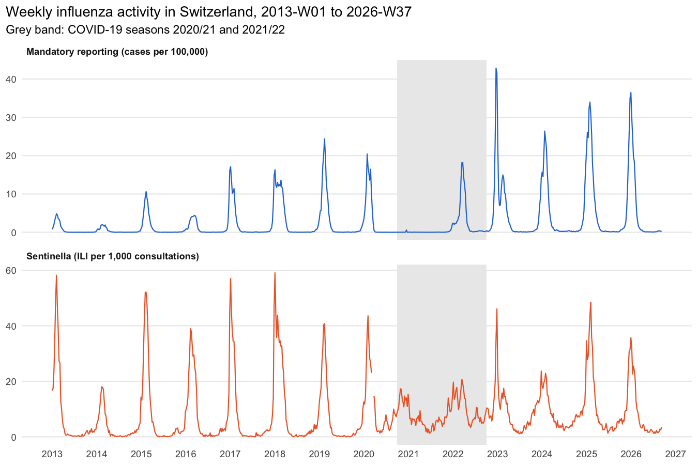
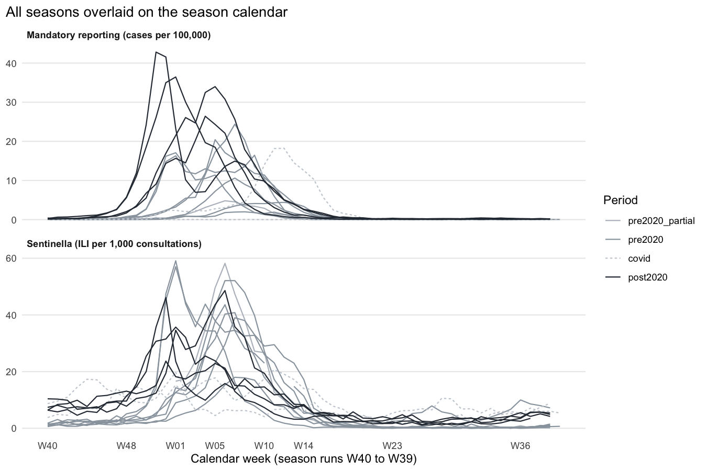
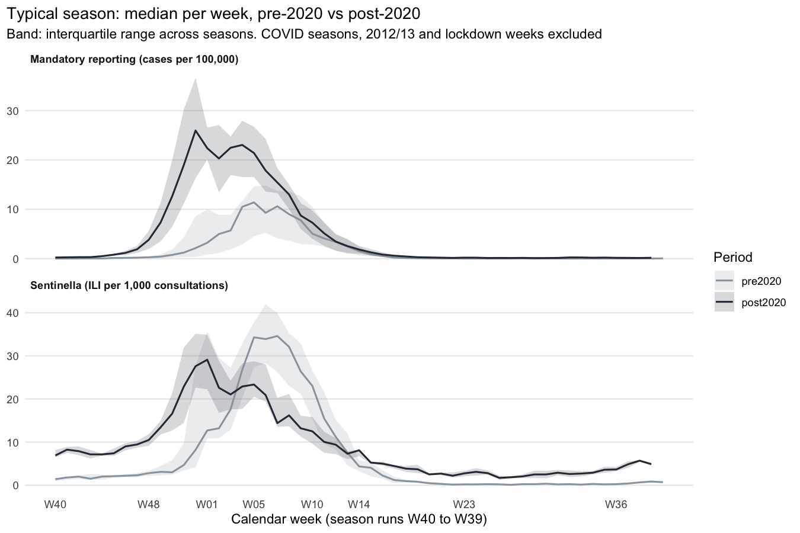
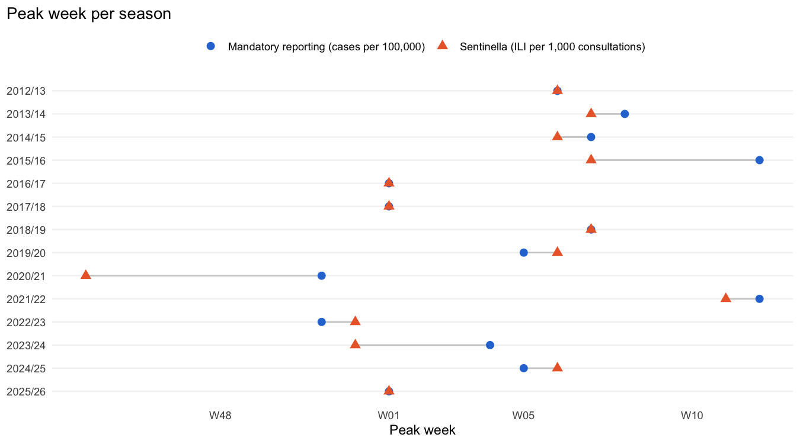
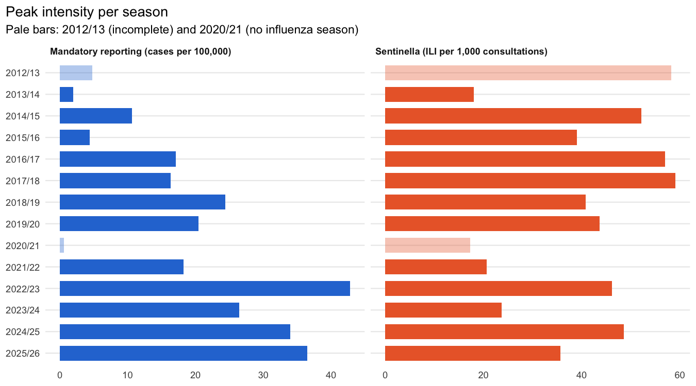

WP 4.2 – Exploratory Analysis
================
S. Ryf (responsible), L. Zovkic (feedback)
14 October 2026

- [1 Data](#1-data)
- [2 Seasonal patterns](#2-seasonal-patterns)
- [3 Peak timing and intensity](#3-peak-timing-and-intensity)
- [4 Season onset and end](#4-season-onset-and-end)
- [5 Unusual observations](#5-unusual-observations)
- [6 Regional variation](#6-regional-variation)
- [7 Key findings for WP 4.3–4.5](#7-key-findings-for-wp-4345)

This report documents work package 4.2 of the Preliminary Study. It is
generated by `scripts/02_eda.R` (tables) and this file (report) from the
datasets of WP 4.1; every number below is computed, not typed.

# 1 Data

The analysis uses the national weekly series (715 ISO weeks, 2013-W01 to
2026-W37, 14 seasons) and the stratified long table (39,325 rows).
Seasons run from W40 to W39. Summary statistics across seasons exclude
the incomplete season 2012/13 and 2020/21 (no influenza circulation);
both are still shown and flagged. Season 2025/26 is included: only the
off-season weeks W38–W39 are missing.

| Season  | Period          | Weeks | Complete | In summary statistics | Test season |
|:--------|:----------------|------:|:---------|:----------------------|:------------|
| 2012/13 | pre2020_partial |    39 | FALSE    | FALSE                 | FALSE       |
| 2013/14 | pre2020         |    52 | TRUE     | TRUE                  | FALSE       |
| 2014/15 | pre2020         |    52 | TRUE     | TRUE                  | FALSE       |
| 2015/16 | pre2020         |    53 | TRUE     | TRUE                  | FALSE       |
| 2016/17 | pre2020         |    52 | TRUE     | TRUE                  | FALSE       |
| 2017/18 | pre2020         |    52 | TRUE     | TRUE                  | FALSE       |
| 2018/19 | pre2020         |    52 | TRUE     | TRUE                  | FALSE       |
| 2019/20 | pre2020         |    52 | TRUE     | TRUE                  | FALSE       |
| 2020/21 | covid           |    53 | TRUE     | FALSE                 | FALSE       |
| 2021/22 | covid           |    52 | TRUE     | TRUE                  | FALSE       |
| 2022/23 | post2020        |    52 | TRUE     | TRUE                  | FALSE       |
| 2023/24 | post2020        |    52 | TRUE     | TRUE                  | TRUE        |
| 2024/25 | post2020        |    52 | TRUE     | TRUE                  | TRUE        |
| 2025/26 | post2020        |    50 | FALSE    | TRUE                  | TRUE        |

# 2 Seasonal patterns

<!-- -->

**Overall pattern.** Both systems show one clear winter wave per season,
with low activity between seasons. The COVID-19 seasons interrupt the
pattern (2020/21 almost without influenza, 2021/22 with a late spring
wave). From 2022/23 the mandatory reporting system runs at a clearly
higher level, while the Sentinella ILI rate does not rise to the same
extent.

<!-- -->

<!-- -->

| System | Period | Seasons | Weeks | Mean | Median | 90th pct. | Max | % weeks = 0 |
|:---|:---|---:|---:|---:|---:|---:|---:|---:|
| Mandatory reporting (cases per 100,000) | pre2020_partial | 1 | 39 | 0.90 | 0.01 | 3.45 | 4.82 | 35.9 |
| Mandatory reporting (cases per 100,000) | pre2020 | 7 | 365 | 1.99 | 0.07 | 7.94 | 24.39 | 15.9 |
| Mandatory reporting (cases per 100,000) | covid | 2 | 105 | 1.35 | 0.03 | 2.94 | 18.23 | 22.9 |
| Mandatory reporting (cases per 100,000) | post2020 | 4 | 206 | 5.23 | 0.48 | 19.10 | 42.81 | 0.0 |
| Sentinella (ILI per 1,000 consultations) | pre2020_partial | 1 | 39 | 9.91 | 0.70 | 35.76 | 58.20 | 0.0 |
| Sentinella (ILI per 1,000 consultations) | pre2020 | 7 | 363 | 7.48 | 2.00 | 27.16 | 59.10 | 3.0 |
| Sentinella (ILI per 1,000 consultations) | covid | 2 | 105 | 8.39 | 6.80 | 15.06 | 20.70 | 0.0 |
| Sentinella (ILI per 1,000 consultations) | post2020 | 4 | 206 | 9.39 | 5.70 | 21.95 | 48.60 | 0.0 |

Weekly values per period

*Interpretation (tbd): typical start, peak and end of the season; level
shift after 2020; how much seasons differ from each other.*

# 3 Peak timing and intensity

Peak week = week of maximum weekly value, peak intensity = that maximum
(Section 4.2), determined separately for both systems. If two weeks
share the maximum, the first is used. The peak lag is the oblig peak
week minus the Sentinella peak week (positive: Sentinella peaks
earlier).

| Season | Period | Peak week (oblig) | Peak (cases/100k) | Peak week (Sentinella) | Peak (ILI/1,000) | Lag (weeks) | Note |
|:---|:---|:---|---:|:---|---:|---:|:---|
| 2012/13 | pre2020_partial | 2013-W06 | 4.8 | 2013-W06 | 58.2 | 0 | incomplete season |
| 2013/14 | pre2020 | 2014-W08 | 2.0 | 2014-W07 | 18.0 | 1 |  |
| 2014/15 | pre2020 | 2015-W07 | 10.6 | 2015-W06 | 52.1 | 1 |  |
| 2015/16 | pre2020 | 2016-W11 | 4.4 | 2016-W06 | 39.0 | 5 |  |
| 2016/17 | pre2020 | 2017-W01 | 17.1 | 2017-W01 | 57.0 | 0 |  |
| 2017/18 | pre2020 | 2018-W01 | 16.3 | 2018-W01 | 59.1 | 0 |  |
| 2018/19 | pre2020 | 2019-W07 | 24.4 | 2019-W07 | 40.8 | 0 |  |
| 2019/20 | pre2020 | 2020-W05 | 20.4 | 2020-W06 | 43.6 | -1 |  |
| 2020/21 | covid | 2020-W51 | 0.6 | 2020-W44 | 17.3 | 7 | no influenza season |
| 2021/22 | covid | 2022-W12 | 18.2 | 2022-W11 | 20.7 | 1 |  |
| 2022/23 | post2020 | 2022-W51 | 42.8 | 2022-W52 | 46.1 | -1 |  |
| 2023/24 | post2020 | 2024-W04 | 26.4 | 2023-W52 | 23.7 | 4 | test season |
| 2024/25 | post2020 | 2025-W05 | 34.0 | 2025-W06 | 48.6 | -1 | test season |
| 2025/26 | post2020 | 2026-W01 | 36.5 | 2026-W01 | 35.7 | 0 | incomplete season |

<!-- -->

<!-- -->

| Period | Seasons | Mean peak week oblig (SD in weeks, range) | Mean peak week Sentinella (SD) | Median peak oblig | Median peak Sentinella | Mean lag in weeks (range) |
|:---|---:|:---|:---|---:|---:|:---|
| pre2020 | 7 | W06 (SD 3.9, W01 to W12) | W05 (SD 2.8) | 16.3 | 43.6 | 0.9 (-1 to 5) |
| covid | 1 | W12 (SD NA, W12 to W12) | W11 (SD NA) | 18.2 | 20.7 | 1.0 (1 to 1) |
| post2020 | 4 | W02 (SD 2.8, W51 to W05) | W02 (SD 2.9) | 35.2 | 40.9 | 0.5 (-1 to 4) |

Peak timing and intensity by period (seasons in summary statistics only)

In 6 of 14 seasons the Sentinella peak comes before the oblig peak, in 5
both peak in the same week and in 3 the oblig peak comes first. The
largest gaps are in 2015/16, 2020/21, 2023/24 (see section 5).

*Interpretation (tbd): peak timing pre vs post 2020; higher oblig peaks
after 2020 partly reflect more testing (compare with Sentinella);
relevance of the peak lag for WP 4.3.*

# 4 Season onset and end

*(next step)*

# 5 Unusual observations

*(next step)*

# 6 Regional variation

*(next step)*

# 7 Key findings for WP 4.3–4.5

*(next step)*
