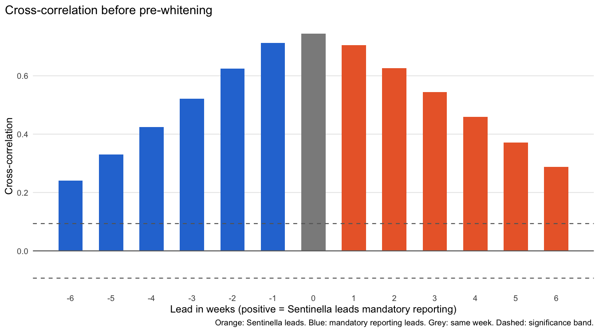
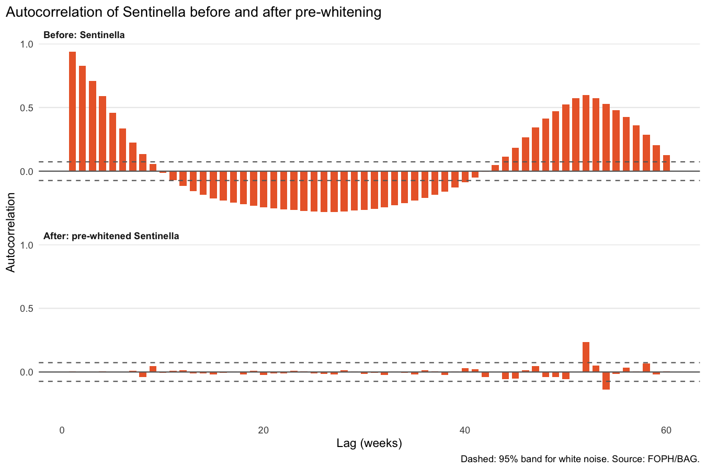
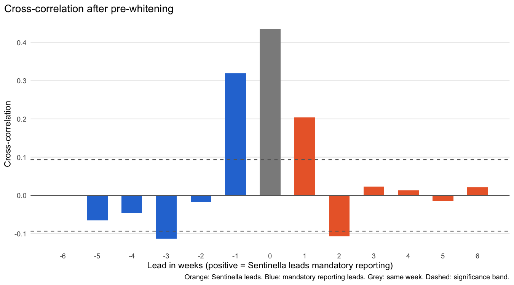
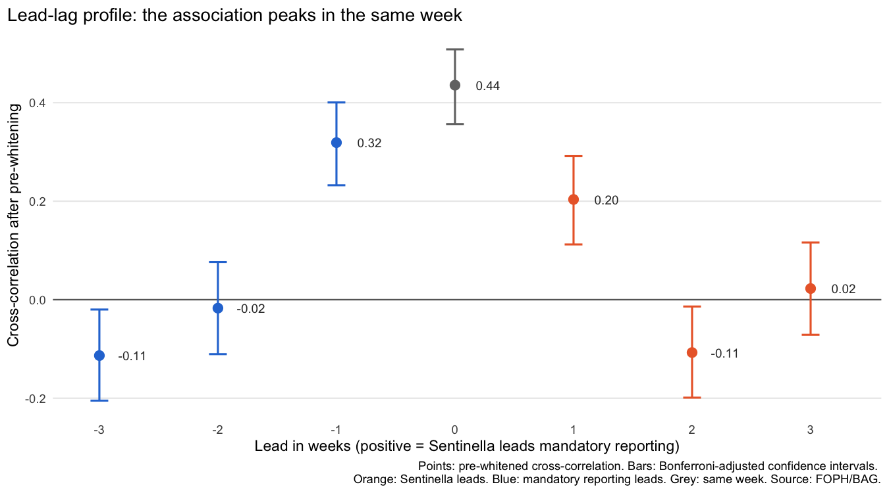
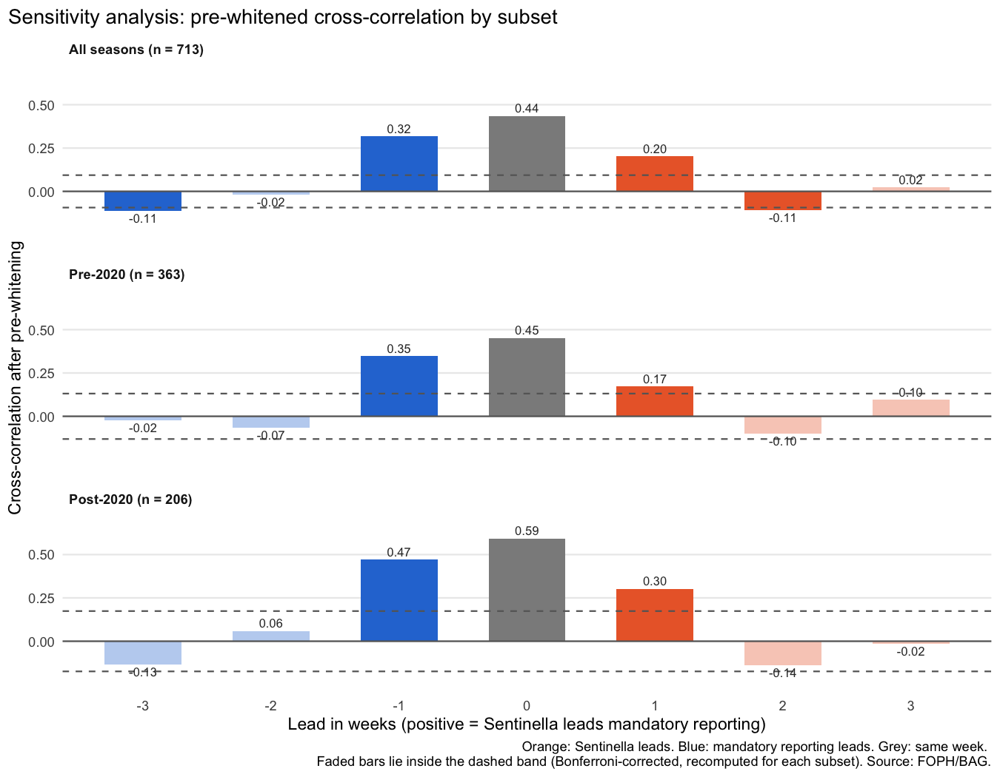
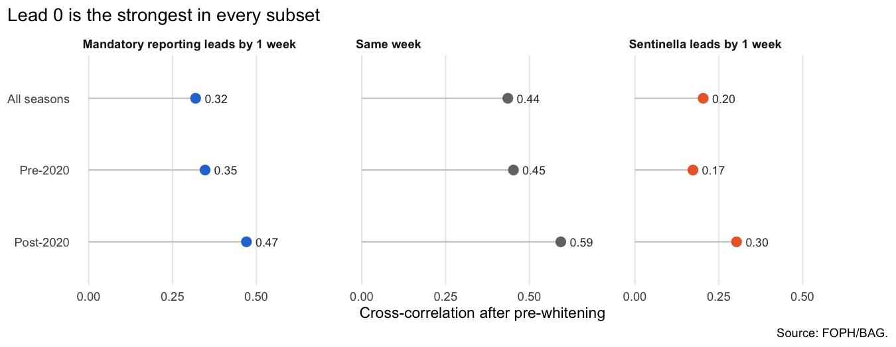

WP 4.3 - Lag Analysis
================
H. Wang (responsible), Q. Xu (feedback)
18 October 2026

- [1 Cross-Correlation](#corss-correlation)
  - [1.1 Naive correlation (before pre-whitening)](#ccf-naive)
  - [1.2 Correlation after pre-whitening](#ccf-white)
- [2 Lag Analysis](#2-lag-analysis)
  - [2.1 Test of hypothesis H1 (leads 0 to 3 weeks)](#h1-test)
  - [2.2 Direction and size of the lag](#lag-direction)
- [3 Sensitivity Analysis: pre- and post-2020 (COVID)](#sensitivity)

This analysis uses the national weekly series of laboratory-confirmed
influenza incidence from mandatory reporting (cases per 100,000
population) and influenza-like illness (ILI) consultations from the
Sentinella system (ILI consultations per 1,000 consultations), both on
their original scale. It covers all 715 weeks from 2013-W01 to 2026-W37,
that is, the seasons 2013/14 to 2025/26 and the second half of season
2012/13, for which reporting in the dataset begins in January 2013.
Sentinella is missing in 2 weeks (2020-W11 and 2020-W12); these were
kept as missing rather than imputed, so correlations use complete pairs
of weeks only (n = 713). Because testing behaviour changed after 2020
(in epidemic weeks, the median number of laboratory-confirmed cases per
unit of ILI rose from 0.29 to 0.72), the analysis was repeated
separately for the periods before and after 2020 (Section
<a href="#sensitivity">3</a>).

# 1 Cross-Correlation

The cross-correlation measures how strongly the two series move together
when one of them is shifted in time. For a shift (lead) of *k* weeks,
Sentinella in week *t* is correlated with mandatory reporting in week
*t* + *k*. A positive lead therefore means Sentinella comes first, and a
negative lead means mandatory reporting comes first. Leads from −6 to +6
weeks were examined. Pairs of weeks with a missing value were skipped.

Under the null hypothesis that two white-noise series are unrelated, a
cross-correlation is approximately normal with mean 0 and standard
deviation 1/√*n*. Because hypothesis H1 concerns four leads (0, 1, 2 and
3 weeks), a Bonferroni correction was applied, giving a significance
band of ±2.50/√*n*.

## 1.1 Naive correlation (before pre-whitening)

<!-- -->

The naive cross-correlation was computed on the original series, using
the 713 weeks in which both systems were reported (significance band
±0.094). All correlations lie far above the band, ranging from 0.24 to
0.74, and they are high in both directions (0.71 when mandatory
reporting leads by one week, 0.74 in the same week and 0.71 when
Sentinella leads by one week). This pattern is expected for two series
that both rise every winter and fall every summer: shared seasonality
and strong week-to-week persistence make the series correlated at almost
any shift. The naive cross-correlation therefore cannot show which
system moves first, and the series were pre-whitened before the timing
was assessed.

## 1.2 Correlation after pre-whitening

Pre-whitening removes from each series the part that is predictable from
its own past, so that only the unexpected week-to-week movements remain.
It was done in three steps. First, the average seasonal cycle was
removed from both series by regressing each on three pairs of Fourier
terms (sine and cosine waves with periods of one year, half a year and a
third of a year) and keeping the residuals. Second, an ARIMA model was
fitted to the deseasonalised Sentinella series, with the model order
chosen by AIC (`auto.arima`); its residuals are the pre-whitened
Sentinella series. Third, the same fitted ARIMA filter was applied,
without re-estimation, to the deseasonalised mandatory reporting series.
Applying one identical filter to both series removes their shared
seasonality and persistence while preserving the timing relationship
between them.

<!-- -->

| Check                                        | Result          |
|:---------------------------------------------|:----------------|
| ARIMA filter (chosen by AIC)                 | ARIMA(5,0,2)    |
| Weeks with both pre-whitened series          | 713             |
| Ljung-Box statistic (lag 10)                 | 2.95 (df = 10)  |
| Ljung-Box p-value                            | 0.98            |
| ACF lags outside the 95% band (lags 1 to 60) | 2 (lags 52, 54) |

Table 1.1: Pre-whitening filter
and white-noise checks for the Sentinella series.

The chosen filter was ARIMA(5,0,2). Before pre-whitening, the
autocorrelation of Sentinella shows the yearly wave (high at short lags,
negative around half a year and high again around one year). After
pre-whitening, almost all autocorrelations lie within the 95% band, and
the Ljung-Box test found no remaining autocorrelation up to lag 10 (p =
0.98). The only remaining values outside the band are at lags 52 and 54,
a small trace of the yearly pattern that arises because seasons differ
in size; it does not affect the short leads examined here. The
pre-whitened series can therefore be treated as approximately white
noise, so the significance band of the cross-correlation is valid.

<!-- -->

| Lead (weeks) | Direction                 | Naive r | Pre-whitened r | Outside band |
|--------------|:--------------------------|---------|----------------|--------------|
| -6           | Mandatory reporting leads | 0.24    | 0.00           | No           |
| -5           | Mandatory reporting leads | 0.33    | -0.06          | No           |
| -4           | Mandatory reporting leads | 0.42    | -0.05          | No           |
| -3           | Mandatory reporting leads | 0.52    | -0.11          | Yes          |
| -2           | Mandatory reporting leads | 0.62    | -0.02          | No           |
| -1           | Mandatory reporting leads | 0.71    | 0.32           | Yes          |
| 0            | Same week                 | 0.74    | 0.44           | Yes          |
| 1            | Sentinella leads          | 0.71    | 0.20           | Yes          |
| 2            | Sentinella leads          | 0.63    | -0.11          | Yes          |
| 3            | Sentinella leads          | 0.54    | 0.02           | No           |
| 4            | Sentinella leads          | 0.46    | 0.01           | No           |
| 5            | Sentinella leads          | 0.37    | -0.01          | No           |
| 6            | Sentinella leads          | 0.29    | 0.02           | No           |

Table 1.2: Cross-correlation between
Sentinella and mandatory reporting, before and after pre-whitening (n =
713 weeks; significance band ±0.094).

After pre-whitening, the cross-correlations fall sharply and form a
clear peak (Table <a href="#tab:ccf-table">1.2</a>). The strongest
correlation is in the same week (r = 0.44), followed by the one-week
shifts in both directions (0.32 when mandatory reporting leads and 0.20
when Sentinella leads). Beyond one week the correlations are close to
zero; the few that cross the band are small and negative and most likely
reflect the filter over-correcting after very large peak weeks rather
than a real negative relationship.

# 2 Lag Analysis

The lag analysis uses the pre-whitened cross-correlations to answer two
questions. First, hypothesis H1: is Sentinella associated with mandatory
reporting at a lead of 0 to 3 weeks? Second, at which lead is the
association strongest, and does it point to Sentinella moving earlier?

For each lead, the test statistic is *z* = *r*·√*n*, where *n* is the
number of complete pairs at that lead; under the null hypothesis of no
association it follows a standard normal distribution. Two-sided
p-values were Bonferroni-adjusted for the four leads in H1 (0 to 3
weeks). Confidence intervals were computed with the Fisher
*z*-transformation at the same Bonferroni-adjusted level (98.75% per
lead, 95% family-wise).

## 2.1 Test of hypothesis H1 (leads 0 to 3 weeks)

| Lead (weeks) | n | r | CI (Bonferroni-adjusted) | p | p (Bonferroni) | Significant |
|---:|---:|:---|:---|:---|----|:---|
| 0 | 713 | 0.44 | 0.36 to 0.51 | \<0.001 | \<0.001 | Yes |
| 1 | 712 | 0.20 | 0.11 to 0.29 | \<0.001 | \<0.001 | Yes |
| 2 | 711 | -0.11 | -0.20 to -0.01 | 0.004 | 0.017 | Yes |
| 3 | 710 | 0.02 | -0.07 to 0.12 | 0.547 | 1.000 | No |

Table 2.1: Test of H1: pre-whitened
cross-correlation at leads of 0 to 3 weeks (positive lead = Sentinella
first).

Sentinella was significantly associated with mandatory reporting in the
same week (r = 0.44, Bonferroni-adjusted p \< 0.001) and at a lead of
one week (r = 0.20, Bonferroni-adjusted p \< 0.001). At a lead of two
weeks the correlation was small and negative (r = -0.11,
Bonferroni-adjusted p = 0.017). Although it crosses the significance
threshold, it points in the opposite direction to H1, which expects a
positive association, and is most likely a side effect of the
pre-whitening filter (Section <a href="#ccf-white">1.2</a>). At three
weeks there was no association (r = 0.02, p = 1.000). H1 is therefore
supported for leads of 0 and 1 week, but not for 2 or 3 weeks.

## 2.2 Direction and size of the lag

<!-- -->

| Shift (weeks) | r, Sentinella leads | r, mandatory reporting leads | Difference (Sentinella minus mandatory) |
|---:|----|---:|---:|
| 1 | 0.20 | 0.32 | -0.12 |
| 2 | -0.11 | -0.02 | -0.09 |
| 3 | 0.02 | -0.11 | 0.14 |

Table 2.2: Comparison of the two
directions at the same shift.

The lead-lag profile peaks at a lead of 0 weeks, that is, in the same
week. If Sentinella detected changes in influenza activity earlier, the
profile would peak at a positive lead, or at least the correlation at +1
week would clearly exceed the correlation at −1 week. The opposite is
observed: at a one-week shift the correlation is 0.32 when mandatory
reporting leads and 0.20 when Sentinella leads (Table
<a href="#tab:direction-table">2.2</a>). At shifts of two and three
weeks, the correlations in both directions are small (between -0.11 and
0.02) and do not show a consistent direction. The significant one-week
correlations in both directions are best explained by unexpected rises
in influenza activity that last somewhat longer than one week, so they
are seen in neighbouring weeks of both systems.

In summary, the two surveillance systems are clearly associated but move
synchronously: there is no evidence that Sentinella provides an earlier
signal than mandatory reporting. Formally, H1 is supported at leads of 0
and 1 week. For the forecasting models in WP 4.4, Sentinella is
therefore included at a lag of 0 or 1 week; whether it improves
forecasts depends on whether its weekly values become available before
complete mandatory reporting data, not on an epidemiological lead.

# 3 Sensitivity Analysis: pre- and post-2020 (COVID)

Testing behaviour changed considerably after 2020, so the pre-whitening
and cross-correlation were repeated separately for the seasons 2013/14
to 2019/20 and 2022/23 to 2025/26, with the COVID-19 seasons excluded
from both. Each subset was pre-whitened from scratch, because the
seasonal shape and the ARIMA filter can differ between periods, and the
significance band was recomputed for the number of weeks in each subset.

<!-- -->

| Subset      |   n | Band  | Lead -3 | Lead -2 | Lead -1 | Lead 0 | Lead 1 | Lead 2 | Lead 3 |
|:------------|----:|:------|---------|---------|---------|--------|--------|:-------|:-------|
| All seasons | 713 | 0.094 | -0.11   | -0.02   | 0.32    | 0.44   | 0.20   | -0.11  | 0.02   |
| Pre-2020    | 363 | 0.131 | -0.02   | -0.07   | 0.35    | 0.45   | 0.17   | -0.10  | 0.10   |
| Post-2020   | 206 | 0.174 | -0.13   | 0.06    | 0.47    | 0.59   | 0.30   | -0.14  | -0.02  |

Table 3.1: Pre-whitened
cross-correlation by subset (positive lead = Sentinella first).

<!-- -->

The pattern was the same in both periods (Table
<a href="#tab:sensitivity-table">3.1</a>). The strongest correlation was
in the same week in every subset (All seasons: 0.44; Pre-2020: 0.45;
Post-2020: 0.59), and the correlation when mandatory reporting leads by
one week was in every subset at least as large as when Sentinella leads
by one week. Correlations were somewhat higher after 2020 (0.59 in the
same week, against 0.45 before 2020), which is consistent with the
larger post-2020 peaks, but the timing of the association did not
change. The change in testing behaviour therefore altered the level of
the relationship between the two systems but not its timing, and the
conclusion of Section <a href="#lag-analysis">2</a> holds in both
periods.
