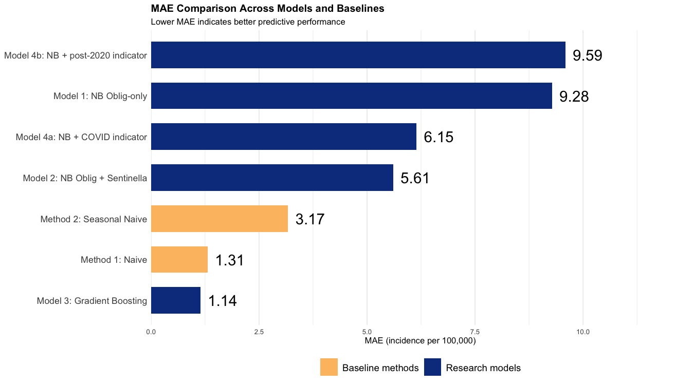
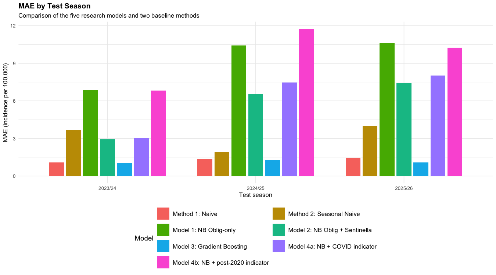
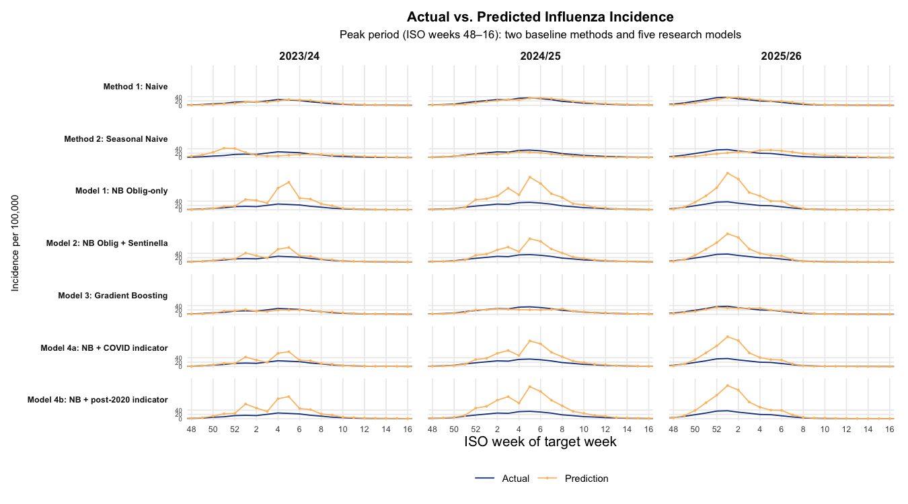

WP 4.4 & 4.5 – Forecasting and evaluation
================
Q. Xu (responsible), H. Wang (feedback)
26 October 2026

- [1 Load data](#1-load-data)
- [2 Build the forecasting dataset](#2-build-the-forecasting-dataset)
- [3 Define the forecasting methods and
  models](#3-define-the-forecasting-methods-and-models)
  - [3.1 Rolling-origin expanding-window
    forecasts](#31-rolling-origin-expanding-window-forecasts)
  - [3.2 Forecasting method 1 — Simple Naive
    Baseline](#32-forecasting-method-1--simple-naive-baseline)
  - [3.3 Forecasting method 2 — Seasonal Naive
    Baseline](#33-forecasting-method-2--seasonal-naive-baseline)
  - [3.4 Model 1 — Negative Binomial GLM
    (Oblig-only)](#34-model-1--negative-binomial-glm-oblig-only)
    - [Interpretation of Model 1
      Forecasts](#interpretation-of-model-1-forecasts)
    - [Interpretation of Model 1
      Coefficients](#interpretation-of-model-1-coefficients)
  - [3.5 Model 2 — Negative Binomial GLM (Oblig +
    Sentinella)](#35-model-2--negative-binomial-glm-oblig--sentinella)
    - [Interpretation of Model 2
      Forecasts](#interpretation-of-model-2-forecasts)
    - [Interpretation of Model 2
      Coefficients](#interpretation-of-model-2-coefficients)
  - [3.6 Model 3 — Gradient Boosting](#36-model-3--gradient-boosting)
    - [Interpretation of Model 3
      Forecasts](#interpretation-of-model-3-forecasts)
  - [3.7 Model 4 — Sensitivity Analyses (COVID-Season and Post-2020
    Indicators)](#37-model-4--sensitivity-analyses-covid-season-and-post-2020-indicators)
    - [Interpretation of Model 4 Sensitivity
      Analyses](#interpretation-of-model-4-sensitivity-analyses)
  - [3.8 Negative Binomial Model
    Diagnostics](#38-negative-binomial-model-diagnostics)
    - [Interpretation of Diagnostic
      Results](#interpretation-of-diagnostic-results)
- [4 Model Validation and Performance
  Comparison](#4-model-validation-and-performance-comparison)
  - [Evaluation of Forecasting
    Performance](#evaluation-of-forecasting-performance)
- [5 Visualisation of Results](#5-visualisation-of-results)
  - [Figure 1: MAE Comparison](#figure-1-mae-comparison)
    - [Interpretation of Figure 1](#interpretation-of-figure-1)
  - [Figure 2: MAE by Test Season](#figure-2-mae-by-test-season)
    - [Interpretation of Figure 2](#interpretation-of-figure-2)
  - [Figure 3: Actual vs. Predicted Influenza
    Incidence](#figure-3-actual-vs-predicted-influenza-incidence)
    - [Interpretation of Figure 3](#interpretation-of-figure-3)
- [6 Conclusion](#6-conclusion)

**Objective**

Forecast next-week influenza incidence in Switzerland and assess whether
Sentinella surveillance information improves predictive performance
beyond mandatory reporting (Oblig), while comparing statistical and
machine-learning forecasting approaches.

**Evaluation strategy**

- Expanding-window, rolling-origin evaluation across three test seasons
  (2023/24–2025/26).\

- Metrics: mean absolute error (MAE) and root mean squared error (RMSE),
  evaluated across all forecast weeks and during in-season weeks.\

- MAE skill score relative to the naive baseline:

  $$
  \text{MAE skill}=1-\frac{\text{MAE}_{\text{model}}}{\text{MAE}_{\text{naive}}}
  $$

  Positive values indicate lower MAE than the naive baseline, zero
  indicates equal MAE, and negative values indicate higher MAE.

**Key comparison**

Model 1 (Negative Binomial GLM, Oblig-only) and Model 2 (Negative
Binomial GLM, Oblig + Sentinella) are compared to assess whether
Sentinella information improves one-week-ahead predictive performance.
Model 3 uses Gradient Boosting, while Models 4a and 4b provide
sensitivity analyses by adding COVID-season and post-2020 indicators,
respectively.

# 1 Load data

The processed national dataset contains weekly influenza surveillance
data from Oblig and Sentinella.\
The in-season classification identifies the weeks considered part of the
influenza season.

# 2 Build the forecasting dataset

Purpose: Prepare the dataset for one-week-ahead forecasting by defining
the forecast origin and next-week target, constructing lagged
predictors, aligning target-week indicators, and identifying candidate
predictors for model selection.

| Component | Candidate rules for the formal model | Rationale |
|:---|:---|:---|
| Oblig AR terms | Consecutive lag combinations: 1; 1–2; 1–3; 1–4 weeks | Consistent with the original protocol’s requirement for multiple autoregressive terms. |
| Fourier terms | K = 1, 2, 3, corresponding to 1, 2, or 3 pairs of annual sine/cosine terms | Consistent with the original protocol’s requirements for seasonality modelling and within-window selection. |
| Sentinella lag | Forecast-origin observation preferred; previous-week observation as a conservative candidate | In WP 4.3, the same-week association was strongest, but evidence that Sentinella leads Oblig was insufficient. |
| Earlier Sentinella lags | Not included as default candidates in the main models | WP 4.3 showed no stable evidence of a 2–3-week lead. |
| Parameter selection | Selected separately within each expanding training window | Avoids using the test seasons to select the model. |

Candidate rules and rationale for the forecasting models

The forecasting dataset contains 715 weekly observations. Missing target
outcomes and candidate predictors were retained as missing rather than
imputed. Observations were excluded from model fitting or evaluation
when the variables required for the corresponding analysis were
unavailable.

The number of in-season evaluation weeks varied across the three test
seasons. The evaluation uses the target-week in-season classification
and the common eligible forecast weeks.

**Target-week indicators and COVID-related data validation**

The COVID-related indicators were successfully mapped to the target
weeks. Among the 714 observations with valid target-week indicators, 403
belong to neither the COVID seasons nor the post-2020 period, 206 belong
to the post-2020 period, and 105 belong to the COVID seasons.

The final row has no target week or target outcome because the dataset
ends at the latest observed origin week. This is expected for
one-week-ahead forecasting and does not indicate a data-joining error.

# 3 Define the forecasting methods and models

We compare two baseline forecasting methods with statistical and
machine-learning models to assess the predictive value of Oblig
incidence and the additional information provided by Sentinella. Model 1
is a Negative Binomial GLM using Oblig autoregressive predictors, while
Model 2 additionally selects a Sentinella predictor. For both models,
the autoregressive lag structure and Fourier terms are selected by AIC
within each expanding training window. Model 3 uses Gradient Boosting
with the predictors selected by Model 2 in the same training window.
Models 4a and 4b extend the combined Negative Binomial GLM with
COVID-season and post-2020 indicators, respectively, as sensitivity
analyses.

## 3.1 Rolling-origin expanding-window forecasts

**Purpose:** Rolling-origin expanding-window forecasts were generated
for the predictive models across the three test seasons (2023/24,
2024/25, and 2025/26). At each forecast origin, the model was fitted
using historical observations that met the training-data eligibility
criteria and used to predict Oblig incidence one week ahead. The
training window expanded as additional observations became eligible. To
reduce the risk of using outcomes before they could reasonably have been
observed, the training data were restricted to observations whose target
week start date was at least seven days before the forecast origin.

Forecasts were evaluated on eligible test weeks with a common set of
observed outcomes and predictors. Performance was assessed using MAE and
RMSE and compared with the simple naive and seasonal naive baselines.
Model specifications for the Negative Binomial GLMs were selected
separately within each training window using AIC.

For model fitting, observations were restricted using the cutoff
condition `target_week_start <= origin_date - 7`, as implemented in the
forecasting code. This restriction was intended to avoid using outcomes
from target weeks that may not yet have been available at the forecast
origin. However, because reports are backfilled and historical data
vintages are unavailable, actual data availability at each forecast
origin cannot be verified.

## 3.2 Forecasting method 1 — Simple Naive Baseline

Purpose: Use the most recently observed Oblig incidence at the forecast
origin as the prediction for the following week. This persistence
baseline requires no model fitting.

<!-- -->

The naive forecast closely tracks the observed Oblig incidence in all
three test seasons (2023/24, 2024/25, 2025/26). Because it simply
carries forward the most recently observed value, it follows the overall
seasonal trajectory but lags the observed series by about one week. This
lag is most visible around the epidemic peak and on the rising and
falling limbs, where the forecast underestimates during the rise and
overestimates during the decline. Outside the influenza season,
incidence is near zero and the forecast matches the observed values
almost exactly.

## 3.3 Forecasting method 2 — Seasonal Naive Baseline

Purpose: Use the Oblig incidence observed 52 weeks before the target
week as the forecast for the following week. This method provides a
seasonal baseline for assessing whether more complex forecasting
approaches improve predictive performance.

<!-- -->

The seasonal naive forecast, based on incidence 52 weeks earlier,
captures the general timing of the seasonal wave but agrees with the
observed data less consistently. In 2023/24, it substantially
overestimates the peak and places it earlier than observed. In 2024/25,
it underestimates the peak magnitude. In 2025/26, the predicted peak
occurs later than the observed one. These discrepancies reflect
season-to-season variation in the timing and intensity of influenza
activity, which a forecast based on the previous year cannot anticipate.

## 3.4 Model 1 — Negative Binomial GLM (Oblig-only)

Model 1 predicts Oblig incidence for the target week using reported
Oblig cases. The response variable is `target_oblig_cases`, and a
population offset is included to account for population size. Predicted
case counts are converted to incidence per 100,000 population. At each
forecast origin, AIC is used to select the autoregressive lag structure
(AR1–AR4) and the number of Fourier terms (K1–K3) from the candidate
specifications, using only the training data available at that origin.

### Interpretation of Model 1 Forecasts

Model 1 generated 154 one-week-ahead forecasts, with 0 missing actual
values, 0 missing predictions, and 0 non-finite predictions.

At each forecast origin, AIC was used to select the auto-egressive lag
structure and the number of Fourier terms using the eligible training
data. The selected model structures were recorded for diagnostic and
reproducibility purposes.

Note: The coefficient estimates, p-values, AIC, and theta reported below
refer to the illustrative fit at the first test forecast origin.
Forecasting performance is evaluated separately using the rolling-origin
expanding-window procedure, with the model re-selected and refitted at
each forecast origin.

    ##              term coefficient standard_error test_statistic   p_value       IRR
    ##       (Intercept)   -13.73000        0.05686      -241.5000 0.000e+00 1.087e-06
    ##  oblig_log_origin     2.79900        0.29010         9.6480 5.015e-22 1.642e+01
    ##   oblig_log_prev1    -1.30400        0.53220        -2.4490 1.431e-02 2.716e-01
    ##   oblig_log_prev2    -0.21120        0.53240        -0.3966 6.916e-01 8.096e-01
    ##   oblig_log_prev3     0.49330        0.28980         1.7020 8.873e-02 1.638e+00
    ##              sin1     0.69230        0.06817        10.1500 3.150e-24 1.998e+00
    ##              cos1    -0.29020        0.07336        -3.9550 7.639e-05 7.481e-01
    ##              sin2     0.06485        0.05862         1.1060 2.686e-01 1.067e+00
    ##              cos2    -0.07952        0.06003        -1.3250 1.853e-01 9.236e-01
    ##              sin3    -0.13530        0.05196        -2.6050 9.188e-03 8.734e-01
    ##              cos3    -0.20820        0.05230        -3.9810 6.853e-05 8.120e-01
    ##  IRR_lower_95 IRR_upper_95
    ##     9.726e-07    1.215e-06
    ##     9.301e+00    2.900e+01
    ##     9.568e-02    7.707e-01
    ##     2.851e-01    2.299e+00
    ##     9.280e-01    2.890e+00
    ##     1.748e+00    2.284e+00
    ##     6.480e-01    8.638e-01
    ##     9.512e-01    1.197e+00
    ##     8.210e-01    1.039e+00
    ##     7.889e-01    9.670e-01
    ##     7.329e-01    8.997e-01

### Interpretation of Model 1 Coefficients

Model 1 uses a Negative Binomial GLM with a log link. Exponentiated
coefficients are interpreted as incidence rate ratios (IRRs),
conditional on the other predictors. The estimated coefficient for the
specified Oblig predictor and its statistical significance should be
interpreted in the context of the illustrative fit. The lagged incidence
terms may be correlated, while the Fourier terms collectively represent
seasonal patterns.

These coefficients describe conditional associations, not forecasting
accuracy. Predictive performance is assessed separately using
rolling-origin MAE and RMSE.

## 3.5 Model 2 — Negative Binomial GLM (Oblig + Sentinella)

Model 2 uses the same candidate autoregressive lag structures and
Fourier terms as Model 1, while additionally selecting between
`sent_log_origin` and `sent_log_prev1`. Model selection is performed
separately within each expanding training window using AIC, without
using information from the future test period.

### Interpretation of Model 2 Forecasts

Model 2 generated 154 one-week-ahead forecasts, with no missing actual
values, missing predictions, or non-finite predictions. At each forecast
origin, the autoregressive lag structure, number of Fourier terms, and
inclusion of lagged Sentinella information were selected using AIC
within the eligible training data. The resulting predictions were used
to evaluate out-of-sample performance using MAE and RMSE. The selected
model specifications were recorded for diagnostic and reproducibility
purposes.

**Note:** The coefficient estimates, p-values, AIC, and theta reported
below refer to an illustrative model fit, rather than a summary of all
rolling-origin fits. Forecasting performance is evaluated separately
using the expanding-window rolling-origin procedure, with the model
re-selected and refitted at each forecast origin.

    ##              term coefficient standard_error test_statistic   p_value       IRR
    ##       (Intercept)   -14.82000        0.11180      -132.5000 0.000e+00 3.671e-07
    ##  oblig_log_origin     2.59200        0.31430         8.2460 1.636e-16 1.335e+01
    ##   oblig_log_prev1    -1.52600        0.57850        -2.6380 8.339e-03 2.174e-01
    ##   oblig_log_prev2    -0.38490        0.58280        -0.6605 5.090e-01 6.805e-01
    ##   oblig_log_prev3     0.90750        0.31470         2.8840 3.926e-03 2.478e+00
    ##              sin1     0.68390        0.08278         8.2630 1.426e-16 1.982e+00
    ##              cos1    -0.32190        0.08376        -3.8430 1.214e-04 7.248e-01
    ##              sin2     0.09988        0.06608         1.5110 1.307e-01 1.105e+00
    ##              cos2    -0.22270        0.06659        -3.3450 8.231e-04 8.003e-01
    ##              sin3    -0.28150        0.05871        -4.7950 1.624e-06 7.546e-01
    ##              cos3    -0.21000        0.05862        -3.5820 3.410e-04 8.106e-01
    ##   sent_log_origin     0.55960        0.07145         7.8320 4.797e-15 1.750e+00
    ##  IRR_lower_95 IRR_upper_95
    ##     2.948e-07    4.570e-07
    ##     7.212e+00    2.472e+01
    ##     6.996e-02    6.756e-01
    ##     2.171e-01    2.133e+00
    ##     1.337e+00    4.591e+00
    ##     1.685e+00    2.331e+00
    ##     6.150e-01    8.541e-01
    ##     9.708e-01    1.258e+00
    ##     7.024e-01    9.119e-01
    ##     6.726e-01    8.467e-01
    ##     7.226e-01    9.093e-01
    ##     1.521e+00    2.013e+00

    ## Illustrative forecast origin: 2023-09-25

    ## Selected AR structure: AR4

    ## Selected Fourier terms: K3

    ## Selected Sentinella predictor: sent_log_origin

    ## Selected AIC: 4415.794

    ## Theta: 1.310614

    ## Number of training observations: 553

### Interpretation of Model 2 Coefficients

**Autoregressive predictors and seasonality.** The Oblig predictors
describe conditional associations with the expected target-week case
count. The Fourier terms represent recurring seasonal patterns.

**Sentinella predictor.** The estimated Sentinella coefficient and its
confidence interval describe the conditional association between the
selected Sentinella predictor and the expected Oblig case count, holding
the other predictors constant.

**Predictive interpretation.** Whether Sentinella improves forecasting
performance cannot be determined from its coefficient or p-value alone.
This is assessed by comparing Model 2 with Model 1 on common
rolling-origin test weeks using MAE and RMSE.

## 3.6 Model 3 — Gradient Boosting

At each forecast origin, the AIC-based predictor selection procedure
used in Model 2 is applied first. The selected predictor set is then
used to fit the Gradient Boosting model. Unlike Model 2, which models
case counts using a Negative Binomial GLM with a population offset,
Model 3 directly predicts `target_oblig_inc_100k`. This allows the
predictive performance of the two modelling approaches to be compared
using the same rolling-origin evaluation framework and consistently
selected predictors.

### Interpretation of Model 3 Forecasts

Model 3 generated 154 one-week-ahead forecasts, with 0 missing actual
values, 0 missing predictions, and 0 non-finite predictions.

Among the finite predictions, predicted influenza incidence ranged from
0.124 to 31.722 per 100,000 population, with a mean of 4.787.

At each forecast origin, the AIC-based predictor-selection procedure
used in Model 2 selected the autoregressive lag structure, the number of
Fourier terms, and the Sentinella predictor. The selected predictors
were then used to fit the Gradient Boosting model, which directly
predicts incidence per 100,000 population rather than case counts.

Model 3 therefore combines the predictor-selection procedure used in
Model 2 with a different prediction algorithm. Its forecasting
performance is evaluated using the same rolling-origin framework and
compared with Model 1, Model 2, and the naive baselines using MAE and
RMSE.

## 3.7 Model 4 — Sensitivity Analyses (COVID-Season and Post-2020 Indicators)

Model 4 comprises two sensitivity analyses based on Model 2, the
Negative Binomial GLM using Oblig and Sentinella data. Model 4a adds a
COVID-season indicator, while Model 4b adds a post-2020 indicator. Both
models are evaluated using the same expanding-window forecasting
framework to assess whether accounting for these periods changes
predictive performance.

### Interpretation of Model 4 Sensitivity Analyses

**Model 4a: COVID-season indicator.**

Model 4a generated 154 one-week-ahead forecasts across 3 test seasons.
The number of forecasts by season was 2023/24: 52; 2024/25: 52; 2025/26:
50. Predicted incidence ranged from 0.052 to 136.519 per 100,000
population, with a mean of 10.962. This sensitivity model extends Model
2, the combined Oblig–Sentinella Negative Binomial GLM, by adding a
COVID-season indicator. It assesses whether accounting for COVID seasons
affects one-week-ahead forecasting performance.

**Model 4b: Post-2020 indicator.**

Model 4b generated 154 one-week-ahead forecasts across 3 test seasons.
The number of forecasts by season was 2023/24: 52; 2024/25: 52; 2025/26:
50. Predicted incidence ranged from 0.075 to 152.033 per 100,000
population, with a mean of 14.62. This sensitivity model extends Model 2
by adding a post-2020 indicator, defined for the period from the 2022/23
season onward, to assess whether accounting for a potential level shift
affects forecasting performance.

**Evaluation.** The two sensitivity models were evaluated across the
test seasons. Their prediction distributions describe the range and
central tendency of the forecasts but do not establish predictive
superiority. Their performance should be compared with Model 2 using MAE
and RMSE on common eligible target weeks.

## 3.8 Negative Binomial Model Diagnostics

The purpose of the convergence diagnostics was to assess whether the two
primary Negative Binomial GLMs (Model 1: Oblig-only and Model 2: Oblig +
Sentinella) could be fitted reliably across the expanding-window
forecast origins. At each forecast origin, the selected predictor set
was reconstructed and the corresponding model was refitted using
eligible training data and the same conservative training cutoff as in
the forecasting procedure.

For each fit, convergence status, fitting warnings, fitting errors, the
estimated dispersion parameter ($\theta$), and Pearson residual
dispersion were recorded. These diagnostics were used to identify
potential numerical fitting problems and possible dispersion-related
concerns. They do not, by themselves, establish overall model adequacy
or predictive accuracy; forecasting performance was evaluated separately
using MAE and RMSE.

The diagnostics focused on Models 1 and 2 because they are the two
primary Negative Binomial GLMs. Model 3 uses Gradient Boosting and is
therefore not subject to Negative Binomial GLM convergence diagnostics.
Models 4a and 4b are sensitivity analyses and were outside the scope of
this primary-model diagnostic check.

| Model | Number of fits | Non-converged | Fits with warnings | Fit errors | Minimum theta | Median theta | Median Pearson dispersion |
|:---|---:|---:|---:|---:|---:|---:|---:|
| Model 1: NB Oblig-only | 154 | 0 | 0 | 0 | 1.076 | 1.122 | 0.960 |
| Model 2: NB Oblig + Sentinella | 154 | 0 | 0 | 0 | 1.307 | 1.390 | 0.785 |

Diagnostic summary for negative binomial models

### Interpretation of Diagnostic Results

**Model fitting diagnostics.** Model 1 (NB Oblig-only) was fitted across
154 forecast origins, while Model 2 (NB Oblig + Sentinella) was fitted
across 154 forecast origins.

The median dispersion parameter ($\theta$) was 1.12 for Model 1 and 1.39
for Model 2. The corresponding median Pearson residual dispersion values
were 0.960 and 0.785, respectively.

These diagnostics summarise model fitting and residual dispersion across
the evaluated forecast origins. They help identify potential numerical
fitting issues and dispersion-related concerns but do not, by
themselves, establish overall model adequacy or predictive accuracy.
Predictive performance is assessed separately using MAE and RMSE.

# 4 Model Validation and Performance Comparison

Before evaluating predictive performance, forecast integrity was checked
for both forecasting methods and all five models. The two forecasting
methods were Method 1 (Naive) and Method 2 (Seasonal Naive). The five
models comprised Model 1 (Negative Binomial GLM using Oblig data only),
Model 2 (Negative Binomial GLM using Oblig and Sentinella data), Model 3
(Gradient Boosting), and two sensitivity models: Model 4a (COVID-season
indicator) and Model 4b (post-2020 indicator).

The integrity checks verified that each method and model produced
forecasts, that target weeks were not missing, and that no duplicate
predictions were generated for the same target week.

Predictive performance was evaluated using mean absolute error (MAE) and
root mean squared error (RMSE), both overall and during influenza-season
weeks. The evaluation was restricted to common target weeks with valid
predictions from both forecasting methods and all five models. The
distribution of common target weeks across test seasons is reported in
the corresponding results table. Performance was also examined
separately for each test season.

Method 1 (Naive) served as the reference for calculating the MAE skill
score. A positive MAE skill score indicates a lower MAE than the Naive
baseline, whereas a negative score indicates a higher MAE. Method 2
(Seasonal Naive) provided an additional benchmark based on observations
from 52 weeks earlier. Both forecasting methods were evaluated alongside
the five models.

The validation and performance evaluation assess forecast integrity and
predictive accuracy, respectively. They do not, by themselves, establish
that a model is universally superior or that its underlying assumptions
are fully satisfied.

### Evaluation of Forecasting Performance

Across the common evaluation weeks, the five research models and two
baseline methods were compared using MAE and RMSE, both overall and
during in-season weeks. Lower MAE indicates smaller average absolute
errors, while RMSE penalises larger errors more strongly. Model rankings
may differ between these metrics and across test seasons. The results
therefore describe performance on the evaluated weeks rather than
guaranteeing future superiority.

# 5 Visualisation of Results

## Figure 1: MAE Comparison

<!-- -->

### Interpretation of Figure 1

Figure 1 compares the mean absolute error (MAE) of the five research
models with the two baseline methods across the common evaluation weeks.
Among the research models, the best-performing research model has the
lowest MAE, followed by the second-best-performing research model.
Performance is measured in cases per 100,000 population.

The Naive baseline (Method 1) has an MAE that is reported in the
corresponding results table, while the Seasonal Naive baseline (Method
2), which uses the observation from 52 weeks earlier, also has its MAE
reported in that table. Comparing the research models with these
baselines helps show whether the more complex forecasting approaches
reduce average absolute prediction errors relative to simple reference
methods.

The best-performing research model can be compared with Method 1 (Naive)
using the MAE results reported in the corresponding results table.
Figure 1 shows MAE only, so the ranking should also be considered
alongside RMSE, which penalises larger forecast errors more strongly.

## Figure 2: MAE by Test Season

| target_season | best_model | best_MAE | naive_MAE | seasonal_naive_MAE |
|:---|:---|---:|---:|---:|
| 2023/24 | Model 3: Gradient Boosting | 1.042388 | 1.085283 | 3.651988 |
| 2024/25 | Model 3: Gradient Boosting | 1.281681 | 1.379898 | 1.902629 |
| 2025/26 | Model 3: Gradient Boosting | 1.093013 | 1.468804 | 3.989194 |

<!-- -->

### Interpretation of Figure 2

Figure 2 shows that forecast accuracy varied across the three test
seasons. Among the research models, **Model 3: Gradient Boosting**
achieved the lowest MAE in 2023/24 (1.04 per 100,000 population),
**Model 3: Gradient Boosting** in 2024/25 (1.28), and **Model 3:
Gradient Boosting** in 2025/26 (1.09).

The Naive and Seasonal Naive methods provide reference benchmarks for
each season. The results highlight seasonal variation in forecasting
accuracy.

## Figure 3: Actual vs. Predicted Influenza Incidence

<!-- -->

### Interpretation of Figure 3

Figure 3 compares observed influenza incidence with one-week-ahead
predictions from the two baseline methods and five research models
during the peak period (ISO weeks 48–16) across the three test seasons.

The predictions from the Naive baseline (Method 1) reflect the most
recently observed incidence level, while the Seasonal Naive baseline
(Method 2) uses observations from 52 weeks earlier to reflect the
corresponding seasonal pattern from the previous year. The degree of
agreement between these baseline predictions and the observed incidence
varies across test seasons.

Among the research models, the predicted trajectories differ in how
closely they follow observed influenza activity and capture changes in
incidence. Some models may overestimate or underestimate peak intensity
in particular seasons. However, visual inspection alone cannot establish
which model performs best quantitatively.

The quantitative evaluation complements this visual comparison. The MAE
and RMSE results for the five research models and both baseline methods
are reported in the corresponding evaluation results table. Because RMSE
penalises larger errors more strongly than MAE, the model with the
lowest MAE does not necessarily have the lowest RMSE.

Overall, Figure 3 provides a visual assessment of how closely the
predicted incidence trajectories follow observed influenza activity
during the peak period. Neither the visual patterns nor a single error
metric alone establishes that one model is uniformly superior across all
seasons and evaluation criteria.

# 6 Conclusion

This study evaluated one-week-ahead influenza incidence forecasting in
Switzerland using an expanding-window rolling-origin approach across
three test seasons (2023/24–2025/26). Two baseline methods were compared
with five forecasting models, including two primary Negative Binomial
GLMs, a Gradient Boosting model, and two sensitivity models
incorporating COVID-season and post-2020 indicators. Predictive
performance was assessed using MAE and RMSE across common evaluation
weeks and during influenza-season weeks.

**Model 3 (Gradient Boosting) was the best-performing model in terms of
overall MAE.** It achieved an MAE of 1.14 incidence per 100,000
population, outperforming the Naive baseline (1.31) and the Seasonal
Naive baseline (3.17). It also achieved the lowest MAE among the
research models in each of the three test seasons, with values of 1.04,
1.28, and 1.09 for 2023/24, 2024/25, and 2025/26, respectively. These
results indicate that Gradient Boosting provided the most accurate
forecasts in terms of average absolute error among the evaluated
approaches.

The comparison between the two primary Negative Binomial GLMs showed
that Model 2, which incorporated Oblig and Sentinella information,
achieved a lower overall MAE (5.61) than Model 1, which used Oblig data
only (9.28). However, Model 2 did not outperform the Naive baseline.
Thus, although adding Sentinella information was associated with
improved MAE relative to the Oblig-only GLM in this comparison, the
results do not demonstrate that it consistently adds sufficient
predictive value to outperform a simple persistence forecast. The
sensitivity analyses also did not improve on the combined model: Model
4a, with a COVID-season indicator, achieved an MAE of 6.15, while Model
4b, with a post-2020 indicator, achieved an MAE of 9.59.

The visual comparison of observed and predicted incidence provided
additional insight into model behaviour during influenza peaks. The
Naive baseline followed recent incidence levels but could lag behind
rapid changes, while the Seasonal Naive baseline was affected by
differences in the timing and magnitude of influenza activity between
seasons. The Negative Binomial models showed deviations from observed
peak intensity in some periods. Although Gradient Boosting achieved the
lowest MAE, its smoother predictions may not capture every rapid
increase or peak accurately. Its overall ranking should therefore be
interpreted alongside RMSE and in-season performance, since different
metrics emphasise different aspects of forecast error.

The convergence diagnostics for Models 1 and 2 identified no
non-converged fits, fitting warnings, or fitting errors across the
evaluated forecast origins. These findings support the numerical
reliability of the fitted models within the diagnostic procedure, but do
not establish that the models are universally adequate or accurate.

Overall, **Model 3 (Gradient Boosting) is the preferred model among
those evaluated when selection is based on MAE**. Nevertheless, the
findings are limited to the three test seasons and the available
surveillance data. Historical data backfilling means that the exact
information available at each original forecast date could not be
verified. Future work should examine additional seasons, compare
performance consistently across MAE and RMSE, and investigate whether
improvements in peak detection can be achieved without sacrificing
overall forecast accuracy..
